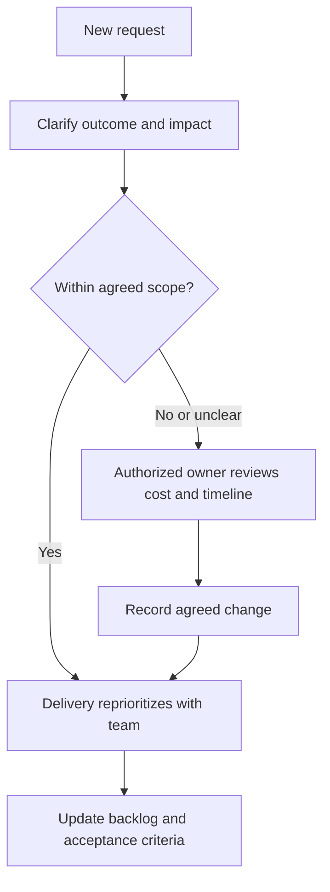

Use a shared work tracker for the plan, a written record for decisions, and a conversation when a quick clarification can prevent rework. Your delivery owner supplies the actual tools and communication channels.

## Make a useful work item

Describe the business problem, user, expected outcome, acceptance criteria, dependencies, and owner. Attach examples using fictional or approved test data. Link the design, change, test evidence, and release note.

A status update should answer four questions:

- What outcome moved forward?
- What is the next action?
- What is blocked, and who can unblock it?
- Has the expected delivery or customer impact changed?

## Suggested team rhythm

This is a starting cadence. Delivery adjusts it for the project and records the agreed rhythm.

| Conversation | Purpose | Written output |
| --- | --- | --- |
| Regular team check-in | Surface progress, dependencies, and blockers | Updated work items and next actions |
| Planning and refinement | Agree scope and clarify acceptance | Ready backlog and known risks |
| Demonstration | Show a working business workflow | Feedback and acceptance gaps |
| Retrospective | Improve how the team delivers | A small set of owned actions |
| Customer checkpoint | Confirm scope, outcomes, and decisions | Decision log and revised plan where needed |

## Handle a change in scope

Do not turn a conversation into an unrecorded commitment. Surface the effect on cost, timing, dependencies, and quality before promising the change.

## Work respectfully

Give feedback about the work and its impact. Ask when a business rule is unclear. Flag a mistake early and help recover it. Raise concerns privately with the appropriate manager or people owner when a team discussion is unsuitable.

Hand over unfinished work with its state, open questions, relevant links, and next responsible person. See [everyday operations](/company/everyday-operations) for attendance, expenses, and assets.
