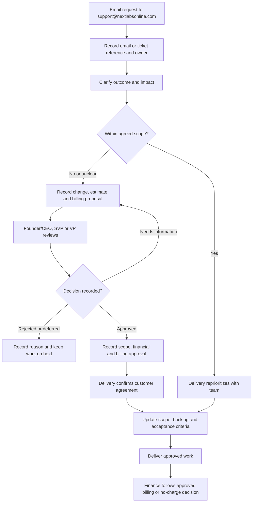

Use a shared work tracker for the plan, a written record for decisions, and a conversation when a quick clarification can prevent rework. Submit all change requests and requests for new changes through [support@nextlabsonline.com](mailto:support@nextlabsonline.com). Your delivery owner supplies the project tracker and team communication channels.

## Make a useful work item

Describe the business problem, user, expected outcome, acceptance criteria, dependencies, and owner. Attach examples using fictional or approved test data. Link the design, change, test evidence, and release note.

A status update should answer four questions:

- What outcome moved forward?
- What is the next action?
- What is blocked, and who can unblock it?
- Has the expected delivery or customer impact changed?

## Suggested team rhythm

This is a starting cadence. Delivery adjusts it for the project and records the agreed rhythm. Use the [delivery methods and workflow diagrams](/delivery/delivery-methods) to choose Waterfall phases, Agile with Kanban, Agile with sprints, or a documented hybrid.

| Conversation | Purpose | Written output |
| --- | --- | --- |
| Regular team check-in | Surface progress, dependencies, and blockers | Updated work items and next actions |
| Planning and refinement | Agree scope and clarify acceptance | Ready backlog and known risks |
| Demonstration | Show a working business workflow | Feedback and acceptance gaps |
| Retrospective | Improve how the team delivers | A small set of owned actions |
| Customer checkpoint | Confirm scope, outcomes, and decisions | Decision log and revised plan where needed |

## Handle a change in scope

Only **Founder/CEO, SVP, and VP** may give final requirement approval or approve out-of-scope work and its financial/billing terms. The Product Owner/Manager documents and tracks the decision; Technical Operations and Senior Manager (Tech/Ops) coordinate clarification and delivery.

First record the request through the [support email intake](/company/ways-of-working#submit-and-track-a-change-request), whether it is within scope or potentially out of scope.

Compare every new request with the agreed project scope. A new feature, integration, report, workflow, or material change to accepted requirements may be out of scope. If the boundary is unclear, delivery records the question and seeks a decision before implementation.

**The authorized leadership approver must approve out-of-scope work and its financial and billing terms in writing before the team commits to or starts the additional work.** Customer interest, a technical estimate, or a delivery discussion does not replace this approval.

## Submit and track a change request

**All change requests and requests for new changes must come through [support@nextlabsonline.com](mailto:support@nextlabsonline.com) before they enter implementation.** This keeps the original request, clarifications, decisions, and delivery history available for future reference.

If a request begins in a call, meeting, chat, or direct message, ask the requester to email it or capture the agreed request in an email to the support address. Link that email thread and any assigned ticket reference to the project work item.

| Include in the request | What to provide |
| --- | --- |
| Project or product | Customer/project context and affected module |
| Requested change | Current behavior, desired behavior, and business reason |
| Impact | Affected users, urgency, and requested date with its reason |
| Supporting context | Sanitized examples, screenshots, or links where useful |
| Follow-up | Requester and the existing email/ticket reference for related work |

The support/delivery owner records the request, assigns an owner, and routes scope clarification. Keep clarifications, estimates, approvals, customer agreement, and status updates traceable to the same reference. Link implementation, test evidence, release, and billing records where applicable; record the outcome before closing the request.

Email intake records the request. It does not approve the work or commit to a delivery date. Out-of-scope work still requires the leadership approval below.

Follow the [support cycle and SLA](/support/cycle-and-sla) for triage, ownership, P0–P4 targets, escalation, verification, and closure. P0 recovery targets are within 1 hour, P1 within 24 hours, and P2 within 1 week. The team provides P3/P4 schedules after review.

Use the [change intake template](/reference/templates#change-request-intake). Report urgent incidents through the [incident route](/engineering/releases-and-incidents#incident-flow) immediately; record resulting change requests through the support mailbox.

## Out-of-scope finance and billing approval

Product Owner/Manager coordinates the change record with Technical Operations and Senior Manager (Tech/Ops). Senior Developer provides the technical estimate. Finance prepares or checks the financial and billing proposal. Only the designated approver from Founder/CEO, SVP, or VP makes the final approval decision.

| Approval item | What to record |
| --- | --- |
| Scope | Additional deliverables, exclusions, and acceptance criteria |
| Delivery impact | Effort estimate, dependencies, and timeline changes |
| Financial impact | Additional cost, proposed customer charge, and any discount or no-charge exception |
| Billing terms | Billing basis, currency, invoice trigger or milestone, and payment terms |
| Decision | Approved, rejected, deferred, or returned for clarification; approver, date, and written reference |
| Customer agreement | Confirmation of the approved change and commercial terms before work begins |

Keep written approval and commercial details in the restricted project record. Link that reference from the work item and originating support email/ticket. A no-charge change still needs approval from the designated Founder/CEO, SVP, or VP because it consumes capacity and affects delivery.

Finance prepares and processes billing against the approved change; it does not independently authorize extra work, a discount, or a billing waiver. If scope, price, or billing terms change after approval, return the revised request to the authorized leadership approver before proceeding.

Use the [change request template](/reference/templates#out-of-scope-change-request). Clarification and estimation can inform the decision; implementation remains on hold until approval and customer agreement are recorded.

## Work respectfully

Give feedback about the work and its impact. Ask when a business rule is unclear. Flag a mistake early and help recover it. Raise concerns privately with the appropriate manager or people owner when a team discussion is unsuitable.

Hand over unfinished work with its state, open questions, relevant links, and next responsible person. See [everyday operations](/company/everyday-operations) for attendance, expenses, and assets.
