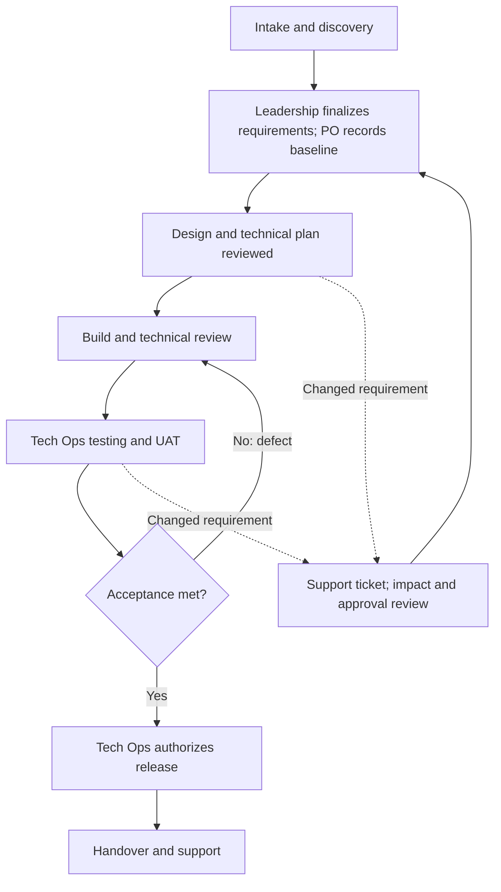
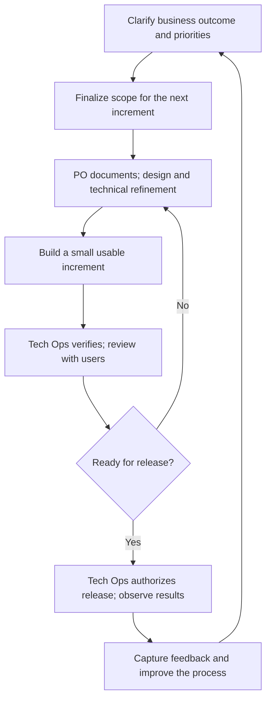
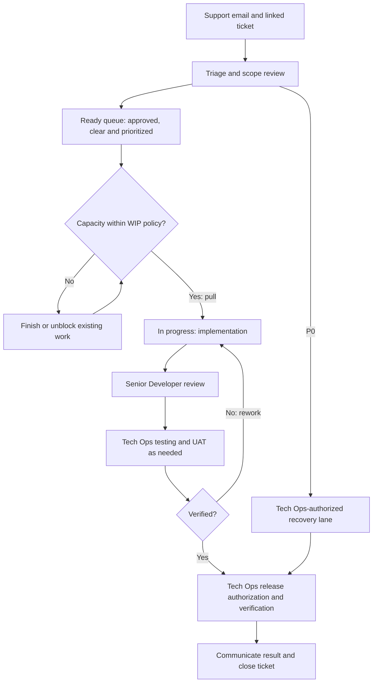
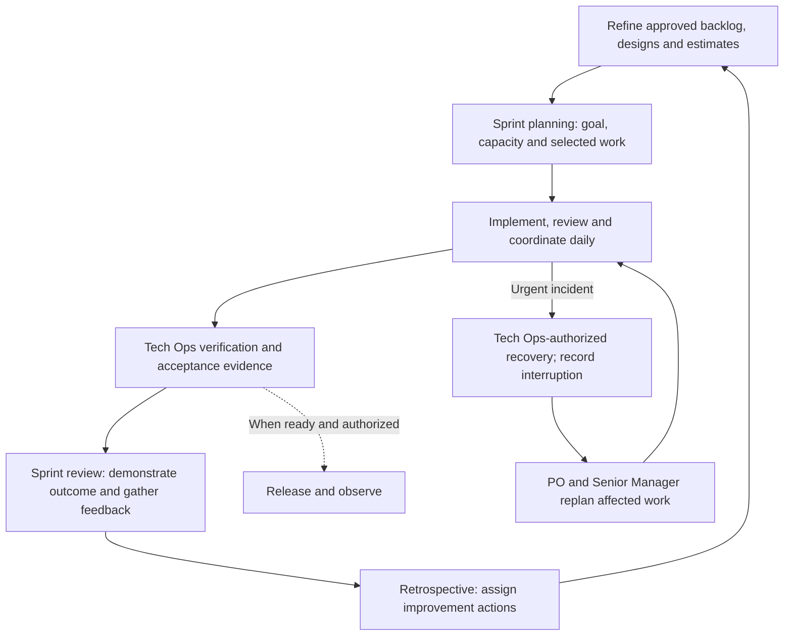
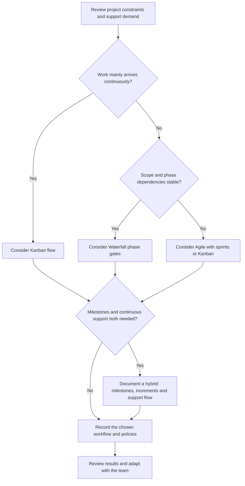

Choose a delivery method that fits the project's uncertainty, dependencies, customer availability, and support load. Record the choice with the Product Owner/Manager, Technical Operations, and Senior Manager (Tech/Ops). Keep the same [role responsibilities](/company/roles-and-responsibilities), [approval rules](/company/ways-of-working#handle-a-change-in-scope), and [support targets](/support/cycle-and-sla) in every method.

<Note>
  This page provides operating guidance. NextEdge has not mandated a single method, sprint duration, or WIP limit for every project. Record those choices in the project workspace before using them to make commitments.
</Note>

## Understand the terms

**Waterfall** organizes delivery into planned phases with reviewed outputs before moving forward. It fits work whose requirements and dependencies are well understood. See [PMI's description of predictive and Waterfall life cycles](https://www.pmi.org/learning/library/matching-software-development-life-cycles-environment-7961).

**Agile** is an approach based on frequent delivery, customer collaboration, feedback, and adaptation. Teams learn from working increments and adjust the next work. See the [Agile Manifesto principles](https://agilemanifesto.org/principles.html).

**Kanban** manages flow: visualize the work, control work in progress (WIP), and pull new items when capacity is available. It can support Agile delivery or other workflows. A board alone does not establish Kanban. See [The Kanban Guide](https://kanbanguides.org/the-kanban-guide/2025.5/).

**Sprint-based Agile** organizes work into repeated, fixed-duration planning periods with a goal, review, and improvement cycle. Scrum uses Sprints of one month or less and defines additional accountabilities, events, and artifacts. NextEdge's workflow below uses sprint planning without declaring full Scrum adoption or adding a Scrum Master role. See the [Scrum Guide](https://scrumguides.org/scrum-guide.html).

| Approach | How work moves | Best fit to consider | Main risk to manage |
| --- | --- | --- | --- |
| Waterfall | Through agreed phase gates and milestones | Stable scope, known integrations, fixed handover dependencies | Discovering a mistaken assumption late |
| Agile with Kanban | Small items pulled continuously as capacity opens | Support, maintenance, frequent arrivals, uneven work sizes | Starting too much or leaving old tickets blocked |
| Agile with sprints | An agreed goal and selected work for a fixed period | Product increments with enough ready work and available reviewers | Overloading a sprint or hiding interruptions |
| Hybrid | Milestone governance with iterative delivery and/or a support flow | ERP rollout with contractual milestones and evolving modules | Conflicting plans or duplicated trackers |

Agile does not mean undocumented work or unlimited scope. Kanban and sprints can both support Agile principles; a team can also visualize sprint work on a board.

## Waterfall: deliver through phase gates

Prepare the requirement baseline, design, implementation plan, verification, and release as explicit phases. Product Owner/Manager maintains the milestone plan and exit evidence. Test planning and risk review begin early, even when formal verification is a later gate.

At each gate, record the deliverable, reviewer, unresolved risks, and decision to proceed. A change reopens the affected baseline and phases through [change control](/company/ways-of-working#handle-a-change-in-scope). Do not treat an approved design as permission to implement a newly discovered business rule.

**Illustrative fit:** a Food and beverages ERP rollout with agreed outlet setup, migration dependencies, and an accepted cutover plan. Confirm actual project constraints before choosing this approach.

## Agile: deliver, learn, and adapt

Start with a business outcome and deliver a small, usable slice. Review it with the relevant users, capture evidence, and use what you learn to shape the next increment. Choose Kanban flow or sprint cadence to organize the work.

Founder/CEO, SVP, or VP finalizes new or changed requirements before implementation; Product Owner/Manager records the approved increment. Existing approval may cover the planned work. Record its reference rather than creating a new leadership gate for every technical task.

**Illustrative fit:** improving a Pharma ERP ordering journey in usable increments, then reviewing real user feedback before selecting the next improvement. Membership and loyalty remain modules within Pharma ERP.

## Kanban: pull work through a visible flow

Use one linked work record from intake to closure. Define the board's start and finish points, entry/exit rules, owners, and WIP limits. The team agrees limits for its capacity; this handbook sets no numeric limit.

Blocked work stays visible and counts within the agreed WIP policy. Name the blocker owner and next action. Review aging work before starting more items. The expedited P0 lane represents the [incident recovery workflow](/support/cycle-and-sla), with Senior Developer and Senior Manager (Tech/Ops) technical help; it does not skip safe-action checks or Tech Ops authorization.

| Routine | Owner and action |
| --- | --- |
| Replenish the ready queue | Product Owner/Manager and Technical Operations clarify, prioritize, and confirm approval/design readiness |
| Review flow regularly | Team checks blocked/aging work, available capacity, and handoffs; Senior Manager coordinates conflicts |
| Pull the next item | Assigned executor starts only when capacity and entry criteria permit |
| Improve the workflow | Team reviews WIP, throughput, cycle time, and work item age, using agreed start/finish definitions |

Cycle time measures started-to-finished work in the board. Support SLA measures elapsed time from receipt; waiting in a queue still consumes the SLA. A flow forecast or service-level expectation does not replace a confirmed SLA.

**Illustrative fit:** ongoing ERP support, defects, small approved changes, and maintenance. Use item types and priorities so new feature work cannot hide a service incident.

## Sprints: plan a goal, inspect, and improve

Agree and record the fixed sprint duration, dates, goal, available capacity, and review participants. Do not promise a sprint full of feature work while leaving support demand unaccounted for.

| Step | Practical workflow and output |
| --- | --- |
| Refinement | PO and Tech Ops clarify approved requirements; Designer supplies usable flows; Senior Developer supplies estimates, dependencies, and risks |
| Planning | PO coordinates the goal and selected work with the team; Senior Manager resolves capacity conflicts; include support load and verification capacity |
| Daily coordination | Developers and Senior Developer surface progress and blockers; PO, Designer, and Tech Ops resolve dependencies as needed; update tickets |
| Verification | Tech Ops records tests and UAT/customer confirmation where required; return failed work for correction |
| Review | Demonstrate usable outcomes, capture feedback and outstanding acceptance gaps; new requirements return to approval/intake |
| Retrospective | Agree a small number of improvements with owners and follow-up; inspect them in the next cycle |

A sprint review does not authorize a production release. Release when the required evidence and Tech Ops authorization are ready; a release may occur during or after the sprint. Keep implementation complete, accepted, and released as distinct states.

If work is unfinished, keep its actual status and remaining estimate. Replan it explicitly rather than marking it done or carrying it silently. If scope changes during a sprint, PO and Senior Manager coordinate the effect on the goal, capacity, and dates; revised requirement or commercial commitments still need the authorized leadership decision.

**Illustrative fit:** a planned mobile app improvement or an ERP module increment with a clear outcome and available design/testing capacity.

## Choose a method or combine them deliberately

A practical hybrid might keep approved ERP milestones, build each module in sprints, and run support through Kanban. Use linked records and one source of status. Make clear which queue owns an item, how it affects capacity, and who communicates a changed forecast. These are examples for project selection, not claims about every current NextEdge project.

## Keep ownership, approvals, and support intact

| Responsibility | Applies in every method |
| --- | --- |
| Final requirements and out-of-scope finance/billing | Designated Founder/CEO, SVP, or VP only |
| Operational coordination | Senior Manager, Technical/Operations coordinates client expectations, capacity, risks, and escalation |
| Requirement record and delivery plan | Product Owner/Manager maintains baseline, backlog, decision links, and status |
| Operational requirements and verification | Technical Operations clarifies workflows and owns testing, UAT, release, and recovery sign-off |
| Experience design | UI/UX/Product Designer owns flows, states, handoff, and experience review as a peer of PO/Manager |
| Technical delivery | Senior Developer plans/reviews and helps recovery; Developers implement and provide evidence |

All new changes enter through [support@nextlabsonline.com](mailto:support@nextlabsonline.com). P0 restore/resolve is within **1 hour**, P1 within **24 hours**, and P2 within **7 calendar days**, measured from receipt in elapsed calendar time. The team provides P3/P4 schedules after review. Queue replenishment, sprint end, lunch, and office closing do not pause these clocks.

For an incident, Technical Operations triages and authorizes recovery; the assigned technical team acts and verifies. PO updates affected delivery work; Senior Manager coordinates the impact and customer updates. Use approved coverage and the [exception process](/company/coverage-and-exceptions) when an owner is unavailable.

Record the selected method, board rules, cadence, and urgent-work policy using the [delivery working agreement](/reference/templates#delivery-working-agreement). Review outcomes and bottlenecks rather than using ticket counts or sprint output as individual performance quotas.
