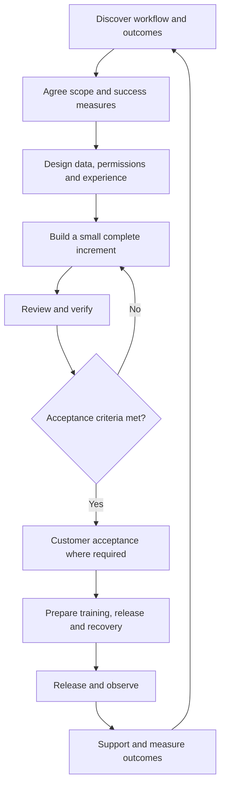

Use this lifecycle as the default delivery guideline. Project size changes the amount of documentation, but should not remove ownership, acceptance criteria, or recovery planning.

## Delivery flow

## Stage responsibilities

| Stage | Lead owner | Output before moving forward |
| --- | --- | --- |
| Discovery | Delivery/business analysis | Workflow, actors, pain points, example records |
| Scope | Delivery with authorized commercial owner | Boundaries, assumptions, dependencies, success measures |
| Design | Technical owner with delivery and UX responsibility | Data flow, permissions, rules, exceptions |
| Build | Assigned contributors | Working increment and implementation evidence |
| Verify | QA with engineering | Acceptance evidence and remaining risks |
| Accept | Designated customer process owner | Recorded acceptance or agreed gaps |
| Release | Named release owner | Release record, recovery plan, support handover |
| Operate | Support/platform with delivery | Issues, operational signals, improvement backlog |

## Start with a complete slice

For an order system, a first slice may capture an order, validate it, show its status, and handle rejection. Form fields without a valid saved order and permission checks are not a complete workflow.

Separate **done for implementation**, **accepted by the customer**, and **released to production**. They need different evidence.

## Measure the result

Pick measures fitting the process: task completion time, repeated entry, fulfillment exceptions, stock discrepancies, support volume, or adoption. Record the baseline and method before claiming improvement.

Use the [project and workflow templates](/reference/templates) and [quality checklist](/delivery/requirements-and-quality).
