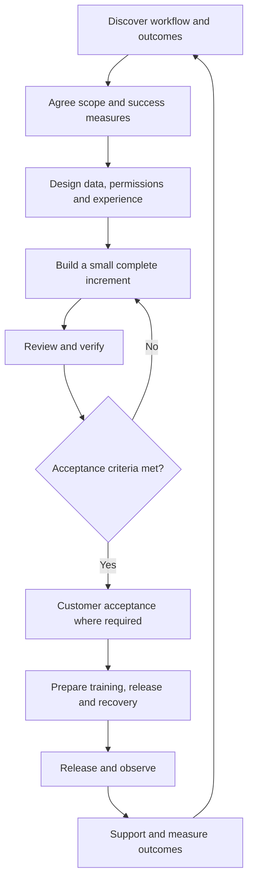

Use this lifecycle as the default delivery guideline. Project size changes the amount of documentation, but should not remove ownership, acceptance criteria, or recovery planning.

The [six-role handoff workflow](/delivery/requirements-and-handoffs) explains how Technical Operations, Product Owner/Manager, Designer, Senior Developer, Developer, and Senior Tech Ops move work through these stages.

## Delivery flow

## Stage responsibilities

| Stage | Lead owner | Output before moving forward |
| --- | --- | --- |
| Discovery | Technical Operations with Product Owner/Manager | Workflow, actors, pain points, example records |
| Scope/finalization | Designated Founder/CEO, SVP, or VP, coordinated by Senior Tech Ops | Finalized boundaries, rules, assumptions, dependencies, decision reference |
| Requirement baseline and plan | Product Owner/Manager with Technical Operations | Versioned document, ready tickets, estimates, dependencies |
| Design | UI/UX/Product Designer with Senior Developer and requirement-owner input | User flow, data flow, permissions, rules, exceptions |
| Build | Developer with Senior Developer planning and review | Working increment and implementation evidence |
| Verify | Tech Ops testing owner with engineering and design input | Acceptance evidence and remaining risks |
| Accept | Tech Ops UAT owner, recording customer confirmation where required | Recorded acceptance or agreed gaps |
| Release | Tech Ops release authority with Senior Developer/Senior Tech Ops technical help | Release record, recovery plan, support handover |
| Operate | Senior Tech Ops with Technical Operations, Product Owner/Manager, and development support | Issues, operational signals, verified recovery, improvement backlog |

## Start with a complete slice

For an order system, a first slice may capture an order, validate it, show its status, and handle rejection. Form fields without a valid saved order and permission checks are not a complete workflow.

Separate **done for implementation**, **accepted by the customer**, and **released to production**. They need different evidence.

## Out-of-scope changes during delivery

Send every change request or request for new changes through [support@nextlabsonline.com](mailto:support@nextlabsonline.com), including changes within the agreed scope. Preserve the original email thread and any assigned ticket reference, and link them to the project work item for future reference.

A new request does not automatically become committed work. Follow the [scope-change approval flow](/company/ways-of-working#handle-a-change-in-scope): record the proposed change, effort and timeline impact, financial impact, and billing terms against that support reference.

Obtain written approval from the designated Founder/CEO, SVP, or VP and record customer agreement before starting the additional work. Finance bills only against the approved terms and agreed trigger or milestone. Return revised scope, pricing, or billing terms for approval; do not absorb the change silently or promise a free addition without authorization.

## Measure the result

Pick measures fitting the process: task completion time, repeated entry, fulfillment exceptions, stock discrepancies, support volume, or adoption. Record the baseline and method before claiming improvement.

Use the [project and workflow templates](/reference/templates) and [quality checklist](/delivery/requirements-and-quality).
