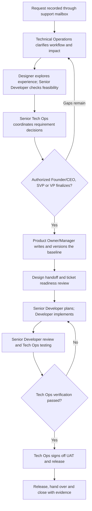
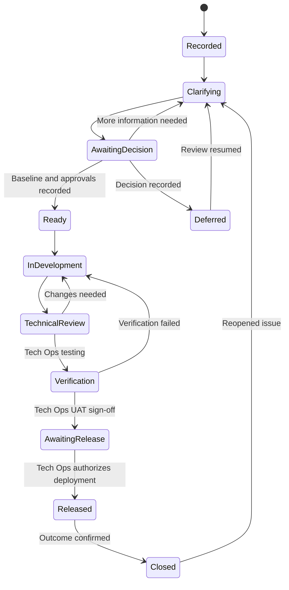
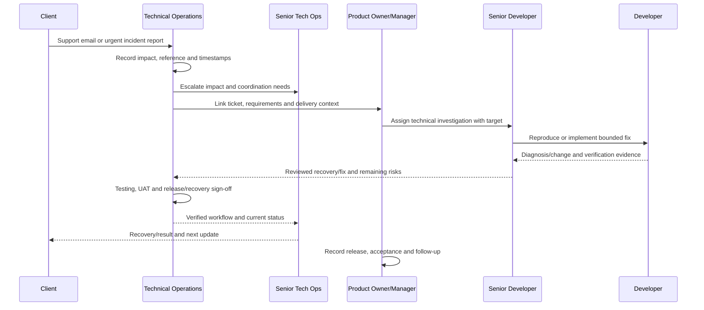

Every request needs a recorded source, an accountable owner, a finalized requirement, and evidence for each handoff. Product Owner/Manager and Technical Operations manage the requirement and delivery process. Senior Developer and Developer own technical planning, implementation, and technical support.

Use the six [role definitions](/company/roles-and-responsibilities) and name the approval authorities in the [project ownership record](/reference/templates#project-ownership-record).

## Requirement to delivery flow

Founder/CEO, SVP, and VP are the only final requirement approvers. Record the designated authorized approver and project approval route. Finalization settles the agreed scope and business rules. The Product Owner/Manager then turns those decisions into a versioned requirement document and actionable tickets. Later questions are recorded as decisions or change requests; they are not resolved by silently rewriting the baseline.

## Handoff checklist

| Handoff | Owner preparing it | Receiver | Required evidence |
| --- | --- | --- | --- |
| Request to discovery | Technical Operations | Product Owner/Manager, Designer, Senior Developer | Original email/ticket, problem, users, current process, impact |
| Discovery to finalization | Senior Tech Ops with Technical Operations | Designated Founder/CEO, SVP, or VP | Rules, scope/exclusions, options, feasibility, risks, decisions needed |
| Finalization to baseline | Product Owner/Manager | Delivery team | Decision reference, requirement version, approved boundaries |
| Baseline to design | Product Owner/Manager and Technical Operations | Designer | User goals, rules, data, roles, acceptance criteria |
| Design to implementation | Designer with Product Owner/Manager | Senior Developer and Developers | Versioned flows/screens, state behavior, approved assumptions |
| Ready work to development | Product Owner/Manager with Technical Operations | Senior Developer and Developer | Owner, estimate, dependency status, linked baseline and design |
| Implementation to verification | Senior Developer and Developer | Tech Ops testing owner | Review result, checks, reproduction steps, affected areas |
| Verification to acceptance/release | Product Owner/Manager with technical input | Tech Ops UAT/release authority | Acceptance evidence, customer feedback, known risks, migration and recovery plan |
| Release to support/closure | Senior Tech Ops with Product Owner/Manager and Technical Operations | Client/support owners | Release reference, confirmed workflow, training, follow-up, closure record |

Missing evidence sends the work back to the role responsible for the gap. The receiver records the question and needed action so the handoff remains traceable.

## What the requirement document contains

- Business outcome, users, operating context, scope, and exclusions.
- Actors, permissions, workflow diagram, and allowed state transitions.
- Inputs, validation, business rules, data ownership, and integrations.
- Normal behavior, error paths, corrections, retries, and offline behavior where relevant.
- Versioned design references and implementation constraints.
- Acceptance criteria covering business, data, permission, and usability outcomes.
- Finalization authority, date, decision reference, and unresolved items.
- Delivery dependencies, change references, and acceptance/release responsibilities.

The document describes finalized requirements. Unresolved decisions remain visible and block only the affected work; they must not be presented as approved behavior.

## Ticket states and ownership

These are suggested tracker states; use equivalent states in the chosen tool. Product Owner/Manager maintains the state and delivery record. The assigned developer or reviewer records their evidence. Every state needs a named owner and next action.

A blocked item retains its history and identifies the blocker owner. Moving it to another state must not hide an SLA miss or reset the support clock.

## Support handoff across roles

This sequence shows normal coordination, not a serial approval queue. For P0, alert Senior Tech Ops and the technical/incident owner immediately; investigation and safe authorized recovery run in parallel with ticket administration. Do not wait for documentation to be rewritten before addressing an outage.

If Senior Developer, Senior Tech Ops, or a Tech Ops primary owner is unavailable, seek the respective owner or authority permission, assign a capable alternate, and coordinate through the [exception workflow](/company/coverage-and-exceptions). Document the permission, executor, verification, and handover.

Keep the confirmed [SLA targets](/support/cycle-and-sla): P0 within 1 hour, P1 within 24 hours, P2 within 7 calendar days; P3/P4 schedules follow team review. A priority does not create production access or override the named recovery authority.

## Change control

Technical Operations records the new or changed request through the support mailbox. Product Owner/Manager links the affected baseline and tickets. Senior Developer provides technical impact; Designer assesses experience changes where needed. Senior Tech Ops coordinates the decision and client implications.

Out-of-scope work and its financial and billing terms follow the [existing approval rule](/company/ways-of-working#out-of-scope-finance-and-billing-approval). Only Founder/CEO, SVP, and VP may finalize requirements or approve out-of-scope work and financial/billing terms. Product Owner/Manager records and implements the decision through the delivery process.

After approval, Product Owner/Manager versions the baseline and plan. Technical Operations confirms the operational changes. The team implements against the new approved version and preserves the earlier history.
