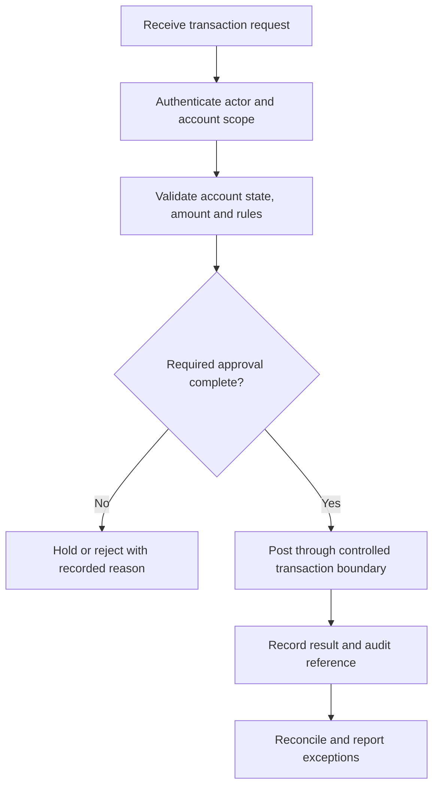

Core banking is a separate domain in the NextEdge portfolio. Its module context covers customer and account lifecycles, deposits, loans, transaction processing, operational controls, and reporting.

The reviewed banking references include account/customer and loan application areas, deposit and loan backend modules, and documented organization, branch, transaction, approval, cash, audit, and reporting scope. Some references are design or schema documentation. Confirm implementation, integrations, and release readiness for the assigned project before describing a feature as live.

## Module map

| Area | Records and responsibilities to understand |
| --- | --- |
| Organization and branch | Tenant boundaries, branch scope, operational roles, and approved configuration |
| Customer and account | Customer records, onboarding status, documents, account ownership, and account lifecycle |
| Deposits | Product configuration, deposit records, schedules, maturity, and related transactions where in scope |
| Loans | Application, review, decision, disbursement, repayment schedule, and collections where in scope |
| Transactions and cash | Posting requests, approvals, transfers, receipts, reversals, and cash controls |
| Approval and access | Initiator/reviewer separation, delegated authority, limits, and record visibility |
| Audit and reconciliation | Traceable events, balanced records, exception handling, and operational reports |

Banking customer membership is a customer/account relationship. It is distinct from the stockist membership and loyalty programs documented under [Pharma ERP](/domains/pharma-erp/membership-and-loyalty).

## Illustrative transaction flow

This diagram is a design guide, not a description of a verified production posting engine. The technical owner must confirm the actual accounting model, posting mechanism, and recovery behavior.

## Integrity and acceptance checks

- Separate initiating, reviewing, and executing an action according to approved project roles.
- Verify tenant, branch, customer, and account scope on the server.
- Define monetary precision, currency, rounding, and business-date rules.
- Preserve posting references and prevent a repeated request from creating a second business effect.
- Keep ledger/posting invariants explicit and test concurrent operations.
- Use attributable reversals or adjustments rather than silently editing posted history.
- Reconcile timed-out external requests before retrying an action that could already have succeeded.
- Verify recovery against both service availability and financial record integrity.

Product terms, interest/fee calculations, approval thresholds, and regulatory obligations require approved project-specific sources. This handbook does not set them.

## Onboarding exercise

Using fictional data, trace a customer to an account, one permitted transaction, its approval, its recorded result, and a reversal or rejected request. Identify the system of record, relevant owners, and the checks that prevent duplicate or unauthorized posting.

Use the [data integrity guide](/engineering/data-and-mongodb), [security guidance](/engineering/security-and-access), and [support cycle](/support/cycle-and-sla) for shared engineering practices.
