Food and beverages ERP connects outlet sales with purchasing, stock, kitchen or factory production, finance, and operational management.

The reviewed project contains business/brand/outlet structures, menu and order handling, billing, shifts, inventory, procurement, production, attendance, and payroll setup modules. The map below consolidates those concerns for onboarding. Confirm each module's enabled features and release status in the assigned project.

## Operational map

```mermaid
flowchart TB
  A["POS sales and outlet demand"] --> B["Inventory movements and availability"]
  B --> C{"Replenishment required?"}
  C -->|Yes| D["Outlet or factory order"]
  D --> E["Production or purchasing"]
  E --> F["Dispatch and receipt"]
  F --> B
  A --> G["Sales and payment records"]
  E --> H["Cost and supplier records"]
  G --> I["Financial reconciliation"]
  H --> I
  B --> J["Operational reports"]
  I --> J
```

## Module responsibilities

| Area | Typical responsibility to validate |
| --- | --- |
| POS | Order capture, sale status, tenders, returns, shift or outlet context |
| Inventory | Stock movements, units, locations, reservations, adjustments |
| Factory orders | Demand, production status, quantities, dispatch, receipt |
| Purchasing | Supplier orders, receipts, discrepancies, related costs |
| Production and recipes | Ingredient units, recipes, material requests/issues, production execution, consumption, and wastage |
| Finance | Traceable sales, payments, expenses, settlements, reconciliation |
| Outlet and workforce operations | Business/brand/outlet roles, shifts, staff attendance, and payroll setup where configured |
| Management reporting | Operational and financial views using agreed definitions |

## Follow one sale

During onboarding, trace a fictional sale from POS to its stock effect and payment record. Then trace a refund or cancellation. Explain which system owns each status and what happens if one integration is delayed.

For factory workflows, trace demand through the order, production or procurement decision, dispatch, and outlet receipt. Record partial quantities and discrepancies explicitly.

## Acceptance checks

- A repeated payment callback does not record a second payment.
- A voided sale and a returned item follow defined stock and financial rules.
- Stock transfers distinguish dispatch from receipt.
- Units and conversion rules remain consistent across outlet and factory.
- Price and tax calculations use the approved rules and rounding strategy.
- Reports reconcile with the underlying movement and transaction records.

Do not silently edit settled financial history or overwrite stock balances to hide a discrepancy. Use a recorded adjustment, reversal, or reconciliation workflow approved for that project.

## Domain boundary

Restaurant billing, tender records, supplier costs, and financial reporting belong to the ERP workflow. The [core banking module](/domains/core-banking) is a separate business domain covering banking account and transaction lifecycles.
