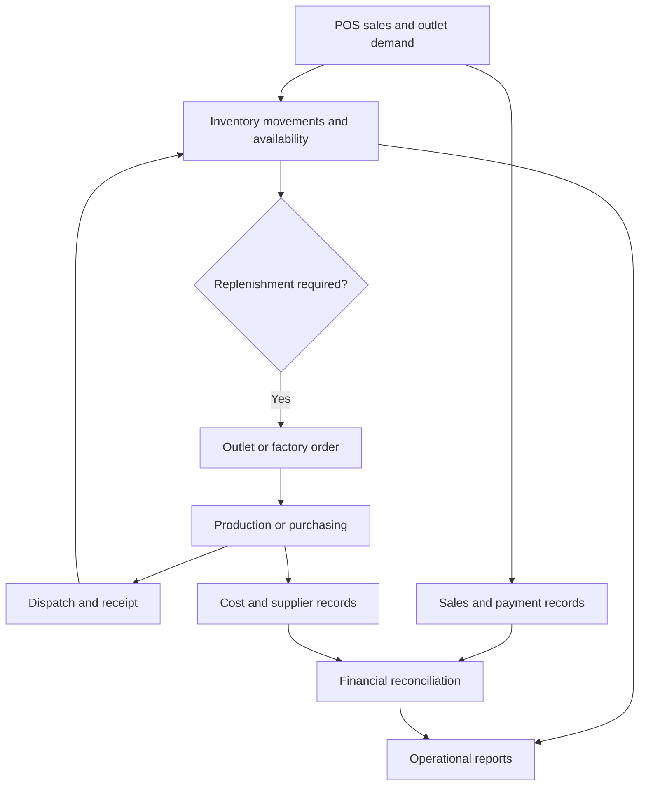

Hoisst ERP is our food and beverages ERP context. It brings POS, inventory, factory order management, finance, and related operational needs into a connected business workflow.

The map below organizes those concerns for onboarding and design. Confirm the modules and integrations present in the assigned project before using it as a feature inventory.

## Operational map

## Module responsibilities

| Area | Typical responsibility to validate |
| --- | --- |
| POS | Order capture, sale status, tenders, returns, shift or outlet context |
| Inventory | Stock movements, units, locations, reservations, adjustments |
| Factory orders | Demand, production status, quantities, dispatch, receipt |
| Purchasing | Supplier orders, receipts, discrepancies, related costs |
| Finance | Traceable sales, payments, expenses, settlements, reconciliation |
| Management reporting | Operational and financial views using agreed definitions |

## Follow one sale

During onboarding, trace a fictional sale from POS to its stock effect and payment record. Then trace a refund or cancellation. Explain which system owns each status and what happens if one integration is delayed.

For factory workflows, trace demand through the order, production or procurement decision, dispatch, and outlet receipt. Record partial quantities and discrepancies explicitly.

## Acceptance checks

- A repeated payment callback does not record a second payment.
- A voided sale and a returned item follow defined stock and financial rules.
- Stock transfers distinguish dispatch from receipt.
- Units and conversion rules remain consistent across outlet and factory.
- Price and tax calculations use the approved rules and rounding strategy.
- Reports reconcile with the underlying movement and transaction records.

Do not silently edit settled financial history or overwrite stock balances to hide a discrepancy. Use a recorded adjustment, reversal, or reconciliation workflow approved for that project.
