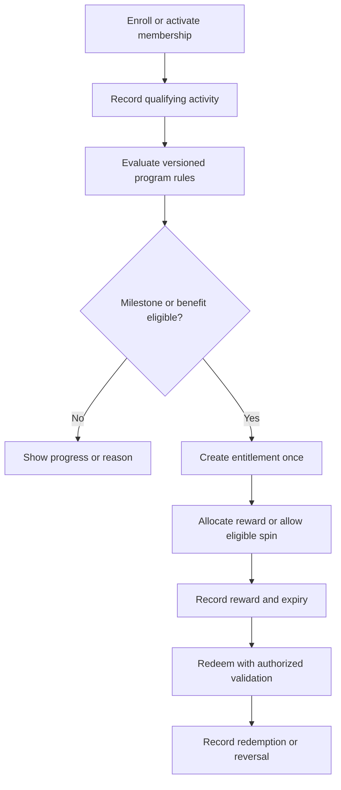
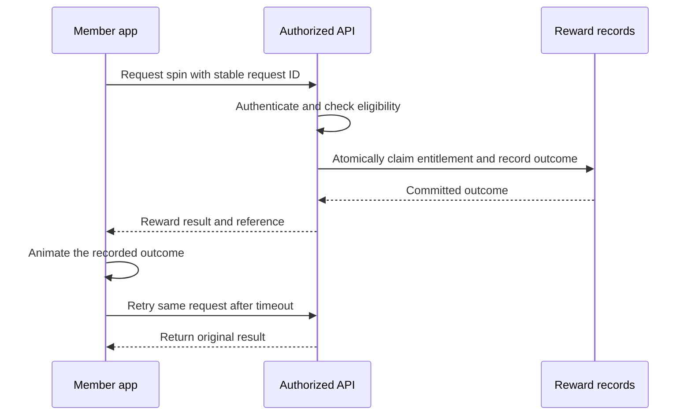

Loyalty can combine membership benefits, milestone achievements, and reward experiences such as spin the wheel. Keep membership status, eligibility, reward allocation, and redemption separate so each can be explained and audited.

## Loyalty lifecycle

## Spin-the-wheel request

This is a target design, not a description of an inspected implementation. Use atomic state changes and uniqueness constraints appropriate to the data model.

## Program rules to agree

| Rule | Question |
| --- | --- |
| Membership | What activates, renews, suspends, or expires membership? |
| Milestone | Which event qualifies, and how do returns affect progress? |
| Benefit | Can it be earned once, once per period, or repeatedly? |
| Spin | Who is eligible, how often, and which reward inventory applies? |
| Redemption | Where, when, and by whom can a benefit be redeemed? |
| Reversal | What happens after fraud, cancellation, or an incorrect award? |

The server determines and stores the reward outcome. The animation displays that outcome. Do not let a client-provided reward ID or a visual result allocate value.

## Acceptance checks

Concurrent spins must not consume the same entitlement twice. A retry returns the original outcome. Exhausted reward inventory needs a defined response. Eligibility uses a recorded rule version and time boundary. Redemption is checked by the server and recorded once.

Program owners must approve the published eligibility and reward terms before launch. This handbook does not specify prize probabilities or commercial terms.
