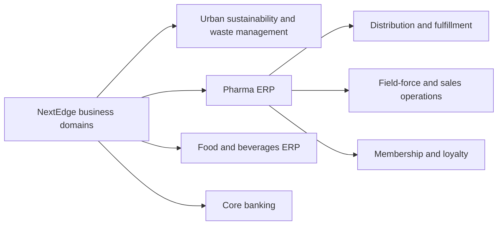

Every domain has its own vocabulary, but the same questions recur: who initiates the work, who can approve it, which records change, and how does an exception reach the right person?

Organize the portfolio by business domain: **urban sustainability and waste management**, **Pharma ERP**, **Food and beverages ERP**, and **core banking**. Workforce operations support the relevant domain workflows. Membership, milestone programs, and spin-the-wheel loyalty are modules of Pharma ERP.

The module maps reflect the reviewed distribution, field-force, food ERP, municipal operations, and banking project references. They guide onboarding and discovery; confirm implementation and release status in the assigned project.

## Domain map

## Business domain guides

<Columns cols={2}>
  <Card title="Urban sustainability" icon="leaf" href="/domains/sustainability">Connect ground activity, evidence, exceptions, and management visibility.</Card>
  <Card title="Pharma ERP" icon="boxes-stacked" href="/domains/pharma-erp">Connect distribution, collections, field-force work, membership, and loyalty.</Card>
  <Card title="Food and beverages ERP" icon="utensils" href="/domains/food-and-beverages-erp">Follow POS, inventory, procurement, production, and financial records.</Card>
  <Card title="Core banking" icon="building-columns" href="/domains/core-banking">Understand customers, accounts, deposits, loans, transactions, and control workflows.</Card>
</Columns>

## Supporting capabilities

[Workforce operations](/domains/workforce) cover attendance, field activity, approvals, expenses, and reporting across relevant projects. They are supporting workflows rather than a substitute for the business domain.

For membership and rewards, start with [Pharma ERP](/domains/pharma-erp), then read its [membership and loyalty module](/domains/pharma-erp/membership-and-loyalty).

## Start every walkthrough with these questions

| Question | Why it matters |
| --- | --- |
| Who does the work and who owns the result? | Defines actors and accountability |
| Which record is the source of truth? | Prevents conflicting status or balances |
| What makes a transition valid? | Defines business rules and permissions |
| What happens offline, on retry, or after a timeout? | Exposes duplicate and lost-work risks |
| How are errors corrected? | Preserves traceability |
| What should management see? | Connects reporting to operational decisions |

Walk through real process examples with the customer using approved, sanitized information. Record project-specific variations instead of assuming a playbook is a complete specification.
