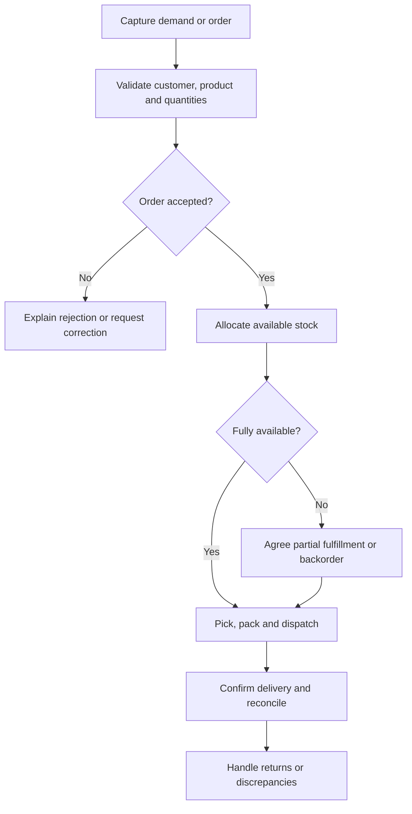
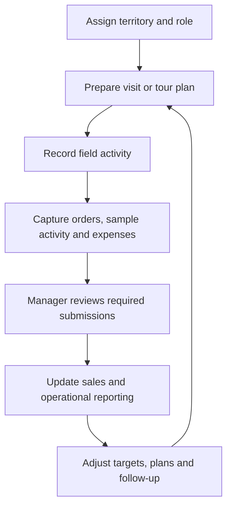

Pharma ERP connects commercial distribution with field-force activity and stockist engagement. Orders and fulfillment are one part of the domain; collections, field planning, reporting, expenses, memberships, milestone programs, and spin-the-wheel rewards also belong in its module map.

The reviewed distribution project includes stockist and admin portals, product/order workflows, invoices, payments, ledger, collections, returns, loyalty, and spin-wheel modules. The reviewed field-force project includes territories, visit planning, activity reports, orders, targets, samples, campaigns, expenses, leave, and management review.

Use these as onboarding areas, not a claim that every module is enabled or fully released for every customer. This playbook covers operational software, not clinical decision-making.

## Module map

| Area | Responsibility and records to understand |
| --- | --- |
| Distribution network | Stockists, super stockists, zones, role scope, and customer/product access |
| Orders and fulfillment | Catalog, cart/order, allocation, dispatch, delivery, returns, and integration state |
| Finance and collections | Invoices, payment evidence, verification, ledger, credit notes, outstanding balances, and follow-up |
| Field-force operations | Territories, visit/tour plans, activity reports, orders, samples, and manager review |
| Sales visibility | Targets, stock/sales statements, campaigns, and performance reporting |
| Workforce support | Field expenses, leave, and approvals appropriate to the assigned role |
| Membership and loyalty | Stockist membership, qualification rules, milestone programs, rewards, spin the wheel, and redemption |
| Support and administration | Tickets, notifications, imports, audit records, and approved configuration |

## Example order flow

Confirm the actual sequence with the customer. An order, shipment, invoice, payment, and return are separate records and may have different owners.

## Field-force workflow

Keep planned activity, reported activity, reviewed activity, and commercial results distinct. A reported visit is not automatically a fulfilled order or a verified payment.

## Membership and loyalty within Pharma ERP

[Membership and loyalty](/domains/pharma-erp/membership-and-loyalty) is a Pharma ERP module, not a separate business domain. Link program participation to the stockist and approved qualifying records. Define how verified receipts, milestones, payment reversals, and returns affect eligibility.

Membership benefits, milestone rewards, and spin-the-wheel outcomes need separate state and audit references. Follow the module guide for allocation, retries, fulfillment, and redemption.

## Rules to discover

| Area | Questions |
| --- | --- |
| Customer and catalog | Who can place an order? Which products and units are available? |
| Commercial validation | Which price list, credit rules, and approval steps apply? |
| Inventory | Are batch, expiry, or storage rules in scope? Who defines them? |
| Fulfillment | Are partial shipments, substitutions, or backorders permitted? |
| Integration | Which system owns stock, invoice, dispatch, and payment status? |
| Returns | Who approves a return and how are stock and financial effects recorded? |
| Field operations | Which territory and reporting scope can each role access? Which submissions need manager review? |
| Membership and loyalty | Which verified activity qualifies, and how do corrections change eligibility? |

## Integrity checks

- A retry must not create a duplicate order.
- Allocation must not silently overcommit available stock.
- Partial fulfillment must preserve remaining quantities.
- Unit conversion, pricing, rounding, and tax inputs need explicit rules.
- A dispatch timeout must trigger status reconciliation, not an assumed failure.
- Return and cancellation rules must account for already fulfilled quantities.
- Field reporting and collection views must respect territory and role scope.
- Membership, milestone, and spin requests must preserve qualifying records and prevent duplicate rewards.

Measure order processing time, manual interventions, backlog age, and fulfillment discrepancies against a recorded baseline. Use [data integrity guidance](/engineering/data-and-mongodb) when order, stock, and financial records change together.
