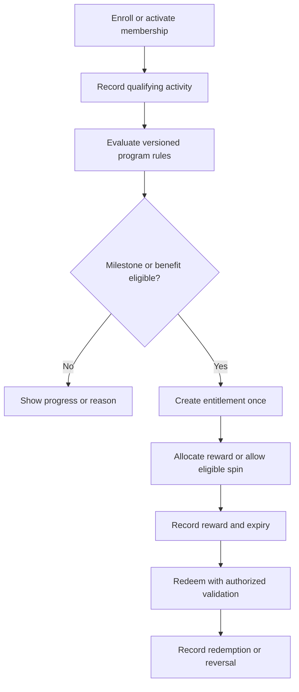
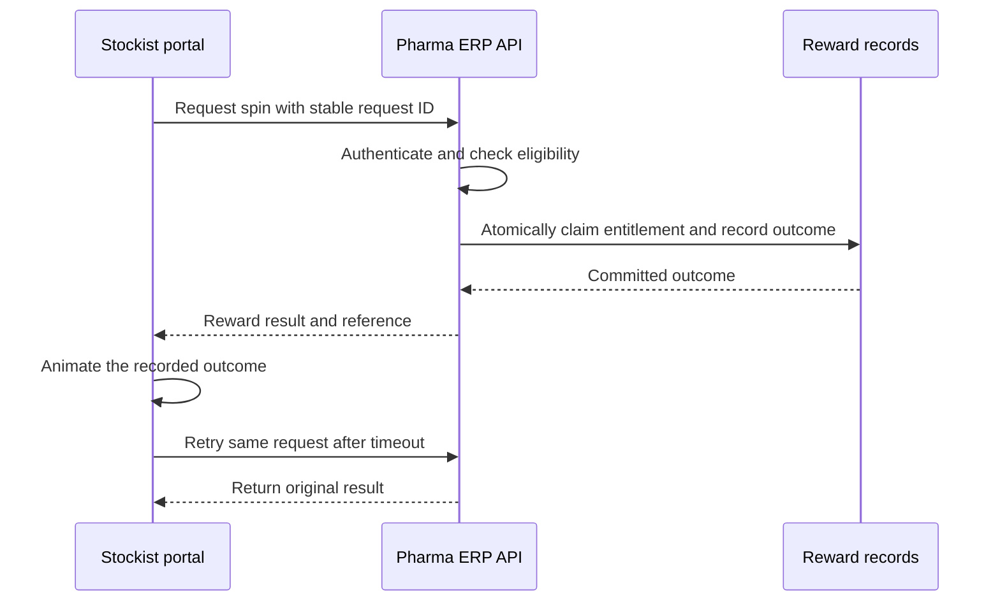

Membership and loyalty belong to [Pharma ERP](/domains/pharma-erp). The module combines stockist membership benefits, milestone-based programs, and spin-the-wheel reward experiences. Keep membership status, qualifying activity, eligibility, allocation, fulfillment, and redemption separate so each can be explained and audited.

The reviewed distribution project includes membership/program rules, loyalty records, spin-wheel handling, and related support ticket context. Configured rules may consider membership tier, stockist scope, verified receipts, overdue amounts, or payment timing. Confirm which rules apply to the assigned program.

## Loyalty lifecycle

## Spin-the-wheel request

This sequence is the recommended integrity model, not a statement that every project version implements it identically. Use atomic state changes and uniqueness constraints appropriate to the data model.

## Program rules to agree

| Rule | Question |
| --- | --- |
| Membership | What activates, renews, suspends, or expires membership? |
| Milestone | Which event qualifies, and how do returns affect progress? |
| Benefit | Can it be earned once, once per period, or repeatedly? |
| Spin | Who is eligible, how often, and which reward inventory applies? |
| Redemption | Where, when, and by whom can a benefit be redeemed? |
| Reversal | What happens after fraud, cancellation, or an incorrect award? |

## Link back to Pharma ERP records

Define the qualifying source event before awarding progress. An order placed, goods dispatched, payment submitted, and funds verified are different events. Use the approved program rule to determine which event qualifies.

Preserve references to the stockist, source transaction, rule version, period, milestone, reward, and any reversal. A returned order, reversed receipt, or rejected payment must follow the program's correction rule without creating duplicate awards.

The server determines and stores the reward outcome. The animation displays that outcome. Do not let a client-provided reward ID or a visual result allocate value.

## Acceptance checks

Concurrent spins must not consume the same entitlement twice. A retry returns the original outcome. Exhausted reward inventory needs a defined response. Eligibility uses a recorded rule version and time boundary. Redemption is checked by the server and recorded once.

Program owners must approve the published eligibility and reward terms before launch. This handbook does not specify prize probabilities or commercial terms.
