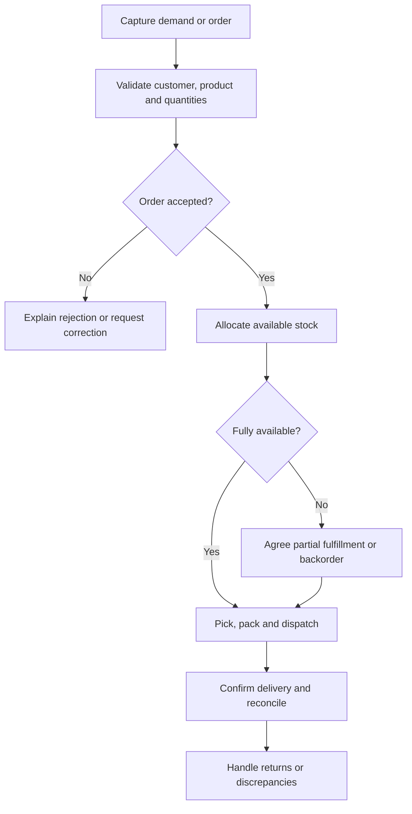

Our pharma work focuses primarily on demand-side operations: automating and scaling orders and fulfillment. Treat the commercial workflow and its data as the starting point. This playbook does not define clinical workflows or assert regulatory certification.

## Example order flow

Confirm the actual sequence with the customer. An order, shipment, invoice, payment, and return are separate records and may have different owners.

## Rules to discover

| Area | Questions |
| --- | --- |
| Customer and catalog | Who can place an order? Which products and units are available? |
| Commercial validation | Which price list, credit rules, and approval steps apply? |
| Inventory | Are batch, expiry, or storage rules in scope? Who defines them? |
| Fulfillment | Are partial shipments, substitutions, or backorders permitted? |
| Integration | Which system owns stock, invoice, dispatch, and payment status? |
| Returns | Who approves a return and how are stock and financial effects recorded? |

## Integrity checks

- A retry must not create a duplicate order.
- Allocation must not silently overcommit available stock.
- Partial fulfillment must preserve remaining quantities.
- Unit conversion, pricing, rounding, and tax inputs need explicit rules.
- A dispatch timeout must trigger status reconciliation, not an assumed failure.
- Return and cancellation rules must account for already fulfilled quantities.

Measure order processing time, manual interventions, backlog age, and fulfillment discrepancies against a recorded baseline. Use [data integrity guidance](/engineering/data-and-mongodb) when order, stock, and financial records change together.
