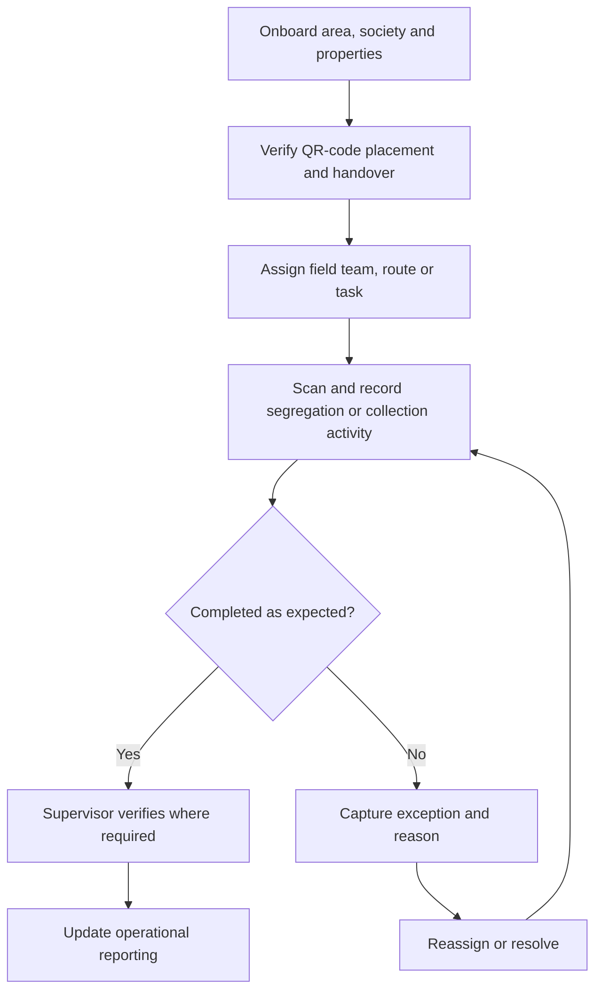

NextEdge's domain experience includes urban city waste management and sustainability. The core product challenge is connecting work performed on the ground with a reliable operational view.

The reviewed municipal field applications cover area/society onboarding, household or property records, QR-code handover, segregation scanning, field collection/logistics roles, supervisor views, complaints, and offline capture/sync. Confirm the enabled workflows in the assigned project.

## Module map

| Area | What the team needs to understand |
| --- | --- |
| Municipal setup | Areas, societies, properties, assignments, and role scope |
| QR onboarding | Generate, hand over, place, and verify codes linked to the right record |
| Field collection | Scan assigned properties or societies and record segregation/collection activity |
| Logistics | Assigned routes, pickup points, vehicle activity, and operational exceptions where enabled |
| Supervision | Review coverage, resolve complaints, and manage assigned areas |
| Offline capture | Persist pending records locally and sync them without duplication |

## Example operating flow

This is an illustrative workflow to validate during discovery, not a claim about any particular deployment.

## Actors and records to clarify

| Actor | Questions to answer |
| --- | --- |
| Field worker | What can be captured offline? What evidence is necessary? |
| Supervisor | Which records need verification? How are missed tasks reassigned? |
| Operations manager | Which areas, tasks, and exceptions need action? |
| Reporting stakeholder | What definitions and evidence support each reported metric? |

Potential records include areas, assignments, activities, timestamps, evidence references, quantities, verification decisions, and exceptions. Agree units and measurement methods before aggregating quantities.

## Acceptance checks

- A task saved offline is not shown as server-verified.
- A repeated upload does not count the same activity twice.
- Evidence is linked to the correct assignment and access boundary.
- Corrections retain the earlier record and reason.
- Dashboard totals distinguish planned, reported, verified, and unresolved work.

Do not infer environmental outcomes from task completion alone. Any sustainability metric needs an agreed definition, data source, and verification method.

## Useful measures

Discuss assignment completion, unresolved exceptions, verification delay, sync failures, and coverage gaps. Define the reporting period, timezone, and denominator so the measures remain comparable.
