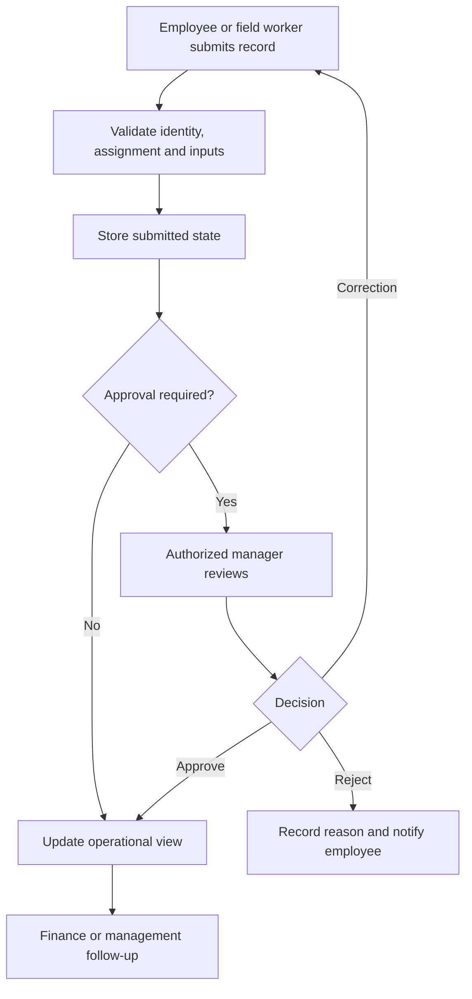

Workforce systems help businesses connect ground activity with management. Attendance, tracking, expenses, approvals, and reporting are supporting capabilities within relevant business domains.

For example, Pharma ERP includes field planning, activity reporting, expenses, and leave workflows; Food and beverages ERP includes shifts, staff attendance, and payroll setup; urban sustainability includes assignments, ground activity, and supervisor visibility. Confirm the actual configured scope in each project.

This page is a product design guide. [Everyday operations](/company/everyday-operations) explains how teammates should use approved NextEdge processes.

## A common workflow

## Keep related workflows distinct

| Workflow | Important distinction |
| --- | --- |
| Attendance | Recorded presence, correction request, and approved correction |
| Field activity | Assignment, reported progress, evidence, and verified completion |
| Expense | Submitted, approved, processed, and paid |
| Leave | Request, decision, and effect on availability under approved rules |
| Management reporting | Aggregated outcomes versus individual source records |

## Design checks

- An employee cannot access another tenant's or unauthorized colleague's records.
- A manager only approves records within their authorized scope.
- A user cannot approve their own request unless the approved rules explicitly permit it.
- Offline submissions and repeated syncs do not duplicate records.
- Corrections retain the original event and the reason for change.
- Location and evidence access are limited to the agreed purpose.

Ask the customer to define retention, visibility, working-day boundaries, overnight shifts, timezone behavior, and delegated approvals. Do not embed assumptions about employment rules in code.

Reports should distinguish missing data from zero activity. Management should be able to identify the source and freshness of a metric before acting on it.
