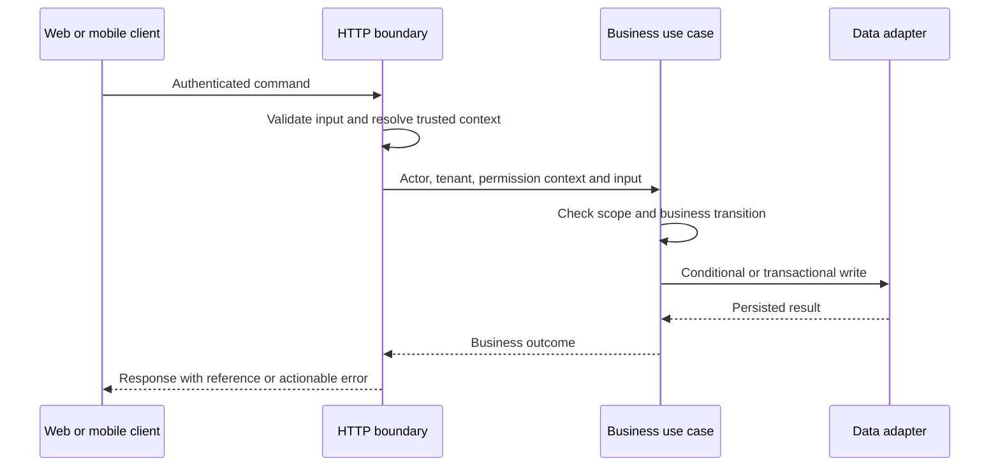
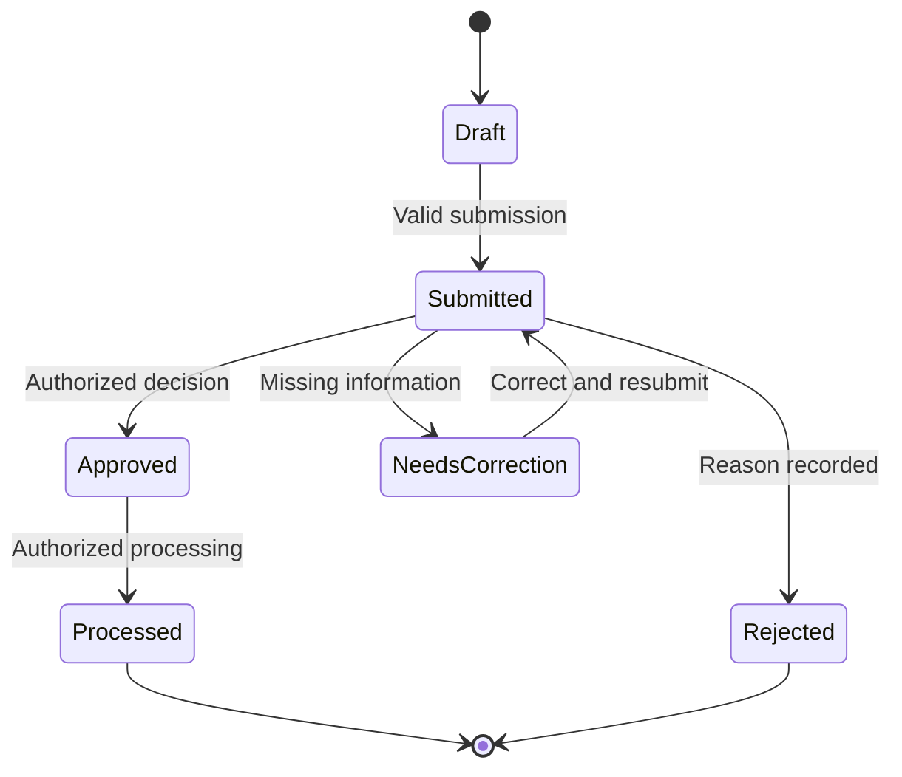

Use Hono or Express as the HTTP boundary. Put business rules in application use cases so web screens, mobile clients, background jobs, and tests use the same logic.

## Request path



Authentication identifies the caller. Authorization decides whether that caller can perform this action on this record. UI visibility is not an authorization control.

## Suggested module structure

This is illustrative; adapt it to the repository's established conventions.

```text
src/
  modules/
    orders/
      http/           # Routes, input validation, response mapping
      application/    # Use cases and transaction orchestration
      domain/         # Rules and state transitions
      persistence/    # MongoDB queries and indexes
      tests/          # Rules, permissions, integration behavior
  shared/
    auth/
    observability/
    integrations/
```

Keep shared code limited to genuinely shared concerns. A large shared folder containing business rules makes ownership harder to understand.

## Contract checklist

- Validate external inputs at runtime; TypeScript alone does not validate JSON.
- Derive tenant and role scope from verified identity and server-side membership.
- Allow only explicitly writable fields; do not spread arbitrary request bodies into database updates.
- Define pagination, filtering, sorting, and maximum batch sizes.
- Use consistent status codes and errors without leaking internal details.
- Make important state-changing requests idempotent where retries are expected.
- Authenticate integration callbacks and handle duplicates and out-of-order events.
- Document compatibility for older mobile clients.

## Example state transitions



This is an example approval workflow. Decide permitted transitions explicitly; reject invalid transitions instead of accepting a client-supplied status.
