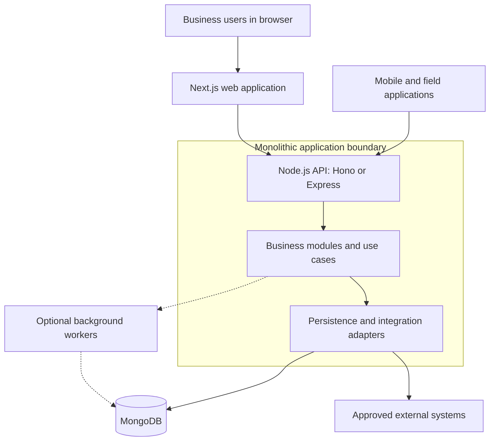
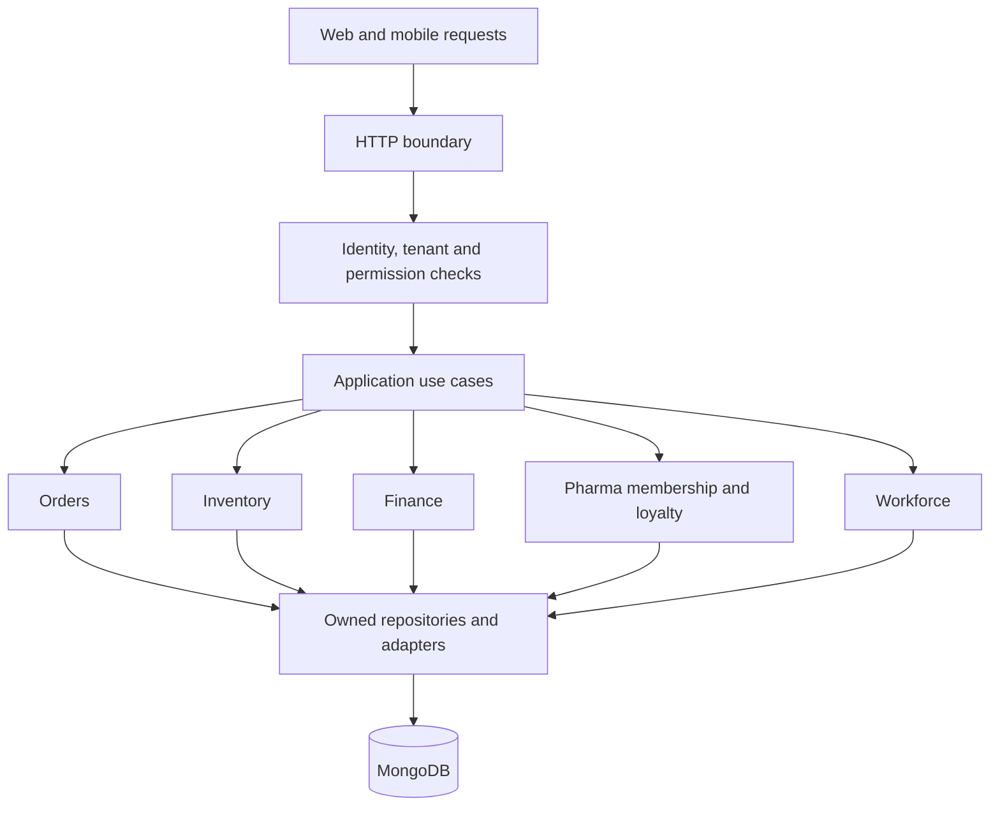

The company direction is a monolithic application architecture using MongoDB, Node.js, Next.js, and Hono or Express in TypeScript. The goal is a system the team can start, understand, and evolve without unnecessary distributed-system overhead.

The diagrams show the recommended organization of that architecture. They are a reference design, not an inventory of an inspected production system.

## System context

Next.js and the API may run together or as separate processes from the same application codebase. “Monolithic” describes shared application ownership and release coupling; it does not require a single machine or one process.

Optional workers are a design extension for slow or retryable work. Their queue, hosting, and implementation must be selected and documented per project.

## Organize the monolith by business capability

These modules are suggested boundaries, not mandatory folders for every project. The membership and loyalty module belongs to Pharma ERP. Core banking uses its own project-specific module map. A module owns its rules and writes. Other modules call its application interface instead of bypassing rules with direct collection updates.

## Why start here

A monolith keeps local setup, debugging, and coordinated changes approachable. Shared TypeScript helps teammates move between web and backend work. MongoDB supports evolving document models as workflows become clearer. Next.js gives the React team several rendering options.

The tradeoff is coupling: a poor module boundary, blocking task, or failed release can affect the wider application. Code review, clear ownership, test coverage, and operational visibility matter from the beginning.

## Grow from evidence

Improve indexes, expensive queries, payloads, and job processing before adding architectural complexity. Add application replicas only after shared state and background work behave correctly. Consider a separate service when ownership, scaling, isolation, or release needs justify its operational cost.

Read the [stack decisions](/engineering/technology-stack), [data guidance](/engineering/data-and-mongodb), and [API boundaries](/engineering/api-and-modules) next.
