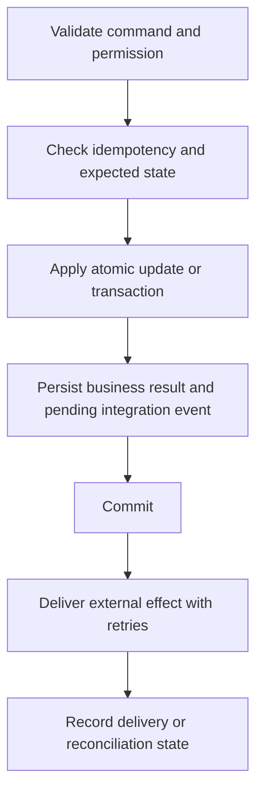

Design data around actual workflows and queries. Define who owns each record, which invariants must hold, and what happens when two requests arrive together.

## Schema flexibility with discipline

MongoDB allows documents in a collection to vary. Add validation for established field types and rules instead of letting accidental variations become the data model. MongoDB provides [collection schema validation](https://www.mongodb.com/docs/manual/core/schema-validation/) in addition to application validation.

Review embedding and referencing against access patterns. Bound growing arrays; avoid a single document that accumulates unlimited orders, events, or history. Record required indexes alongside the queries that need them.

## Integrity rules

| Concern | Engineering guideline |
| --- | --- |
| Tenant isolation | Scope every applicable read and write to the authenticated tenant; test cross-tenant access |
| Uniqueness | Enforce true business uniqueness at the database, including tenant scope where appropriate |
| Concurrent changes | Use conditional updates or transactions for the invariant being protected |
| Money and quantities | Use an explicit precision and rounding strategy; avoid binary floating-point for monetary arithmetic |
| History | Record stock movements, reward events, approvals, and financial adjustments with attributable references |
| Time | Store unambiguous timestamps; define business timezone and period boundaries |
| Relationships | Validate referenced records and lifecycle effects; the database does not infer domain ownership |

## Atomic writes and external effects

MongoDB writes are atomic within one document. A multi-document operation is not automatically atomic as a whole. Use transactions when the business invariant spans documents; transactions require a supported replica-set or sharded deployment. They have cost and do not replace sound modeling. See [atomicity and transactions](https://www.mongodb.com/docs/manual/core/write-operations-atomicity/).

The pending-event approach is a recommended pattern for projects with reliable integration needs. An external payment or notification is not part of a MongoDB transaction. A durable event record, idempotent delivery, and reconciliation handle the gap.

## Evolve a schema safely

Plan how old and new application versions read the data. Prefer a staged change: add compatible fields, deploy compatible readers/writers, backfill in bounded batches, verify results, and retire old fields later. Record migration progress and recovery options.

Test using data shaped like older records, not only fresh fixtures.

## Scale in stages

Measure query latency, scans, index use, document growth, and connection pressure. Improve the model and indexes first. Application replicas and database scaling are separate decisions.

MongoDB [sharding](https://www.mongodb.com/docs/manual/sharding/) distributes data across shards. Shard-key choice, query targeting, distribution, and operational overhead determine whether it helps. A replica set provides redundancy; it is not the same as write sharding.

Backups need an owner, retention requirements, and restore verification. Record actual settings in the restricted project runbook rather than inventing company-wide recovery promises.
