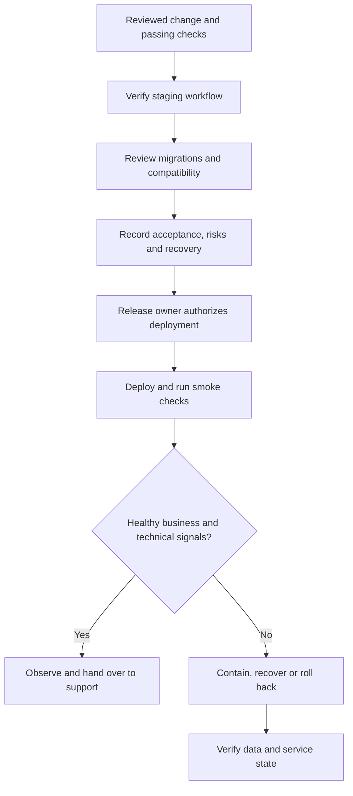
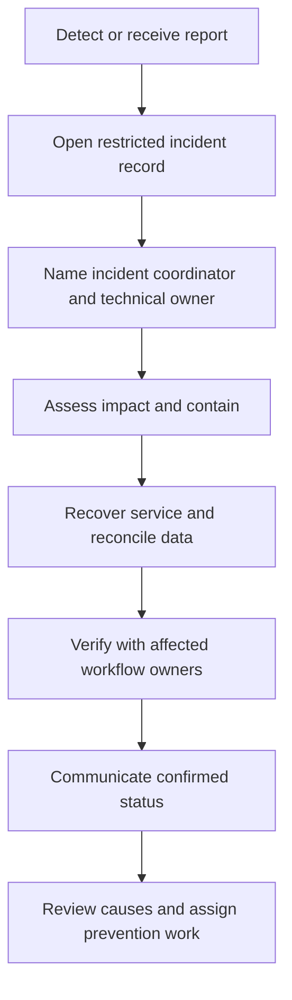

A release changes a live business process. Name the release owner, verify the intended behavior, and know how to recover before deployment.

## Release flow

## Release record

Record the change reference, environments, owner, verification evidence, customer communication needs, migration steps, smoke checks, and recovery decision. Use the [release template](/reference/templates).

A code rollback may not reverse a data migration, external notification, payment, or stock movement. Document those effects and a compatible recovery path separately.

## Observe the business as well as the server

| Signal | Why it matters |
| --- | --- |
| Errors, latency, saturation | Reveals service health and capacity problems |
| Pending or failed jobs | Reveals delayed imports, notifications, and integrations |
| Order and stock discrepancies | Reveals business state that may need reconciliation |
| Duplicate rewards or redemptions | Reveals broken integrity controls |
| Failed field sync | Reveals work the manager may not yet see |
| Backup and restore checks | Confirms a recovery path exists and works |

Follow the [support cycle and SLA](/support/cycle-and-sla) for P0–P4 priorities and targets: P0 within 1 hour, P1 within 24 hours, P2 within 1 week, and P3/P4 scheduled by the team after review. Record alert thresholds, support coverage, escalation contacts, and project-specific recovery procedures in the runbook.

## Incident flow

Escalate immediately when access, money, stock, rewards, or business-critical availability may be affected. Do not wait for a perfect diagnosis. The coordinator assigns investigation and communication roles so recovery work remains focused.

For P0, aim to restore service or contain critical impact within 1 hour using the safest compatible rollback, recovery action, or focused hotfix. Record recovery separately from permanent resolution and closure. Follow the [P0 recovery path](/support/cycle-and-sla#p0-recovery-restore-first-then-complete-the-fix), then reconcile data and assign prevention work.

## Support handoff

Use [support@nextlabsonline.com](mailto:support@nextlabsonline.com) to record change requests and requests for new changes. Preserve the original email thread and any assigned ticket reference throughout triage, implementation, verification, and closure. Follow the [intake and approval workflow](/company/ways-of-working#submit-and-track-a-change-request); mailbox receipt does not authorize implementation.

Provide the affected workflow, reproduction steps using sanitized data, impact, relevant references, workaround if verified, and next update owner. A fix is complete only after the affected workflow and any damaged records have been checked.
