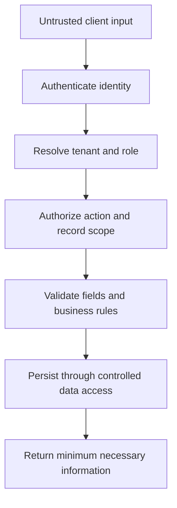

Every contributor should understand which data the application holds and who may act on it. Use the following as engineering guidelines and verify the actual controls in each project.

## Trust boundaries

Apply the same checks to exports, search, background jobs, file access, and reporting. Guessing another record ID must never grant access.

## Working rules

- Keep secrets in the approved secret-management process, outside source control.
- Separate development, staging, and production credentials.
- Avoid logging tokens, passwords, full personal records, or unnecessary location data.
- Authenticate callbacks; validate input and bound request sizes.
- Enforce authorization on the server, including tenant and record ownership.
- Restrict uploads by purpose, size, and type; control who can retrieve them.
- Review dependencies and keep supported versions with a documented update process.
- Record sensitive state changes with the actor, time, action, and relevant reference.

For Express applications, use the official [production security guidance](https://expressjs.com/en/advanced/best-practice-security/), including secure transport, input handling, and dependency maintenance. Equivalent controls must be verified for Hono projects.

## Security scenarios to test

| Scenario | Expected result |
| --- | --- |
| Tenant A requests Tenant B's record or export | Access denied without data disclosure |
| A user sends a role or tenant ID in a writable body | Server ignores or rejects unauthorized scope changes |
| An expired or revoked session is reused | Access rejected |
| A callback is repeated or arrives out of order | No duplicate effect or invalid transition |
| A privileged action is attempted from a hidden UI route | Server authorization still applies |

## Report an incident

Raise suspected credential exposure, unauthorized access, or data loss through the [incident process](/engineering/releases-and-incidents). Share evidence in the restricted incident record. Do not paste secrets into the public handbook or public issues.

The handbook can describe controls and responsibilities. Customer records, employee records, environment addresses, access lists, and detailed incident evidence belong in approved restricted systems.
