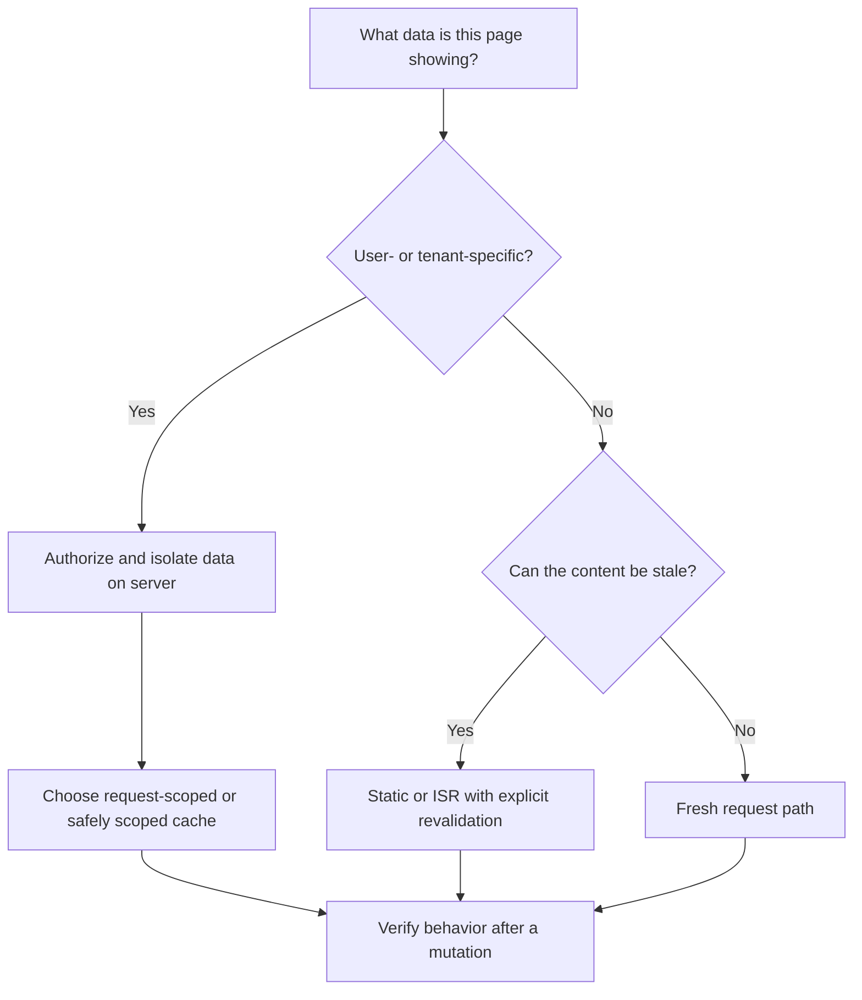
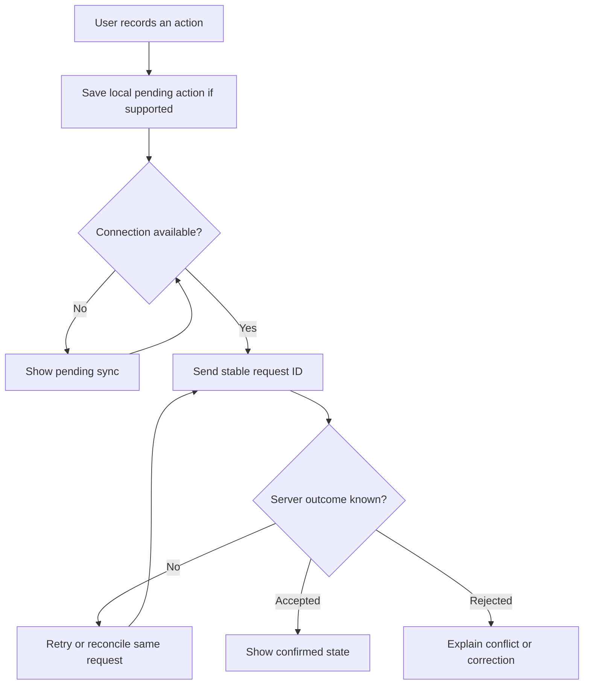

Next.js is the React framework in our stated stack. Use its rendering options deliberately. Mobile applications share business contracts with the backend; their framework is project-specific in this edition.

## Rendering choices

| Approach | Typical fit | Decision to make |
| --- | --- | --- |
| CSR: client-side rendering | Interactive dashboards and rich forms | Loading, errors, access checks, and client fetch freshness |
| SSR: server-side rendering per request | Request-specific or personalized initial content | Server authorization, latency, and caching boundaries |
| Static rendering | Stable public content | When a rebuild is needed |
| ISR: incremental static regeneration | Public content that can tolerate controlled staleness | Revalidation triggers, delay, and invalidation |

CSR and SSR can coexist. A Client Component may still have an initial server-rendered preview. Server Components do not by themselves guarantee fresh per-request data.

ISR regenerates cached content according to its configured behavior; it is not a guarantee that every request sees the latest business state. See the [Next.js ISR guide](https://nextjs.org/docs/app/guides/incremental-static-regeneration) and [server/client component guide](https://nextjs.org/docs/app/getting-started/server-and-client-components).

## Cache according to the data

Do not put private tenant data in a shared public cache. After a stock, approval, or reward change, show the committed server result and refresh the affected view according to the project's caching design.

## Mobile and field connectivity

Offline support is a product decision, not a default promise. Define which actions can be queued, how conflicts resolve, and what data stays on the device. Do not show an unconfirmed stock reservation, attendance approval, or reward as completed.

## Experience checklist

Provide loading, empty, success, and actionable error states. Support keyboard navigation and clear labels. Confirm destructive actions where needed. Test small screens, slow connections, permission denial, expired sessions, and older supported app versions.
