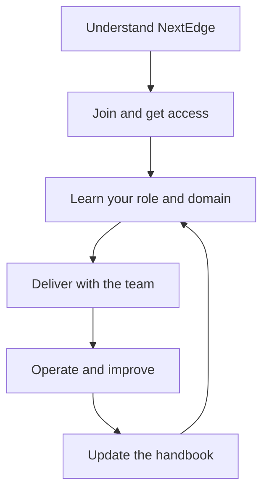

NextEdge is an IT services company with eight years of experience building ERP systems and mobile applications for businesses. Our work connects people on the ground with managers and decision makers, reduces repetitive work, and makes operations easier to track.

This handbook gives you a shared starting point: what we build, how teams work together, how you get started, and the engineering decisions behind our products.

<Info>
  **Handbook · 13 October 2026.** Company background, technology direction, six-role responsibilities, support intake, and SLA targets come from the company brief. Confirmed reporting, approval boundaries, working hours, and exception workflows are documented. Named owners, coverage contacts, and other employment policies are maintained through the [owner register](/reference/handbook-governance).
</Info>

## Find your starting point

<Columns cols={2}>
  <Card title="Join the team" icon="handshake" href="/onboarding/journey">
    Follow the first-day, first-week, and 30/60/90-day onboarding path.
  </Card>
  <Card title="Understand the company" icon="building" href="/company/overview">
    Learn our business, domains, and the outcomes our customers need.
  </Card>
  <Card title="Know who owns what" icon="sitemap" href="/company/organization">
    Understand functions, project teams, decisions, and escalation.
  </Card>
  <Card title="Explore the architecture" icon="layer-group" href="/engineering/architecture">
    See how TypeScript, Next.js, Node.js, and MongoDB fit together.
  </Card>
</Columns>

## How the handbook fits together

| Section | What you will find | Who should read it |
| --- | --- | --- |
| Company handbook | Business context, organization, onboarding, working practices, domain guides | Everyone |
| Engineering | Architecture, data, APIs, web/mobile, testing, releases, security | Engineers, QA, technical delivery |
| Reference | Reusable templates, glossary, ownership and maintenance | Everyone |

## What good work looks like

Understand the workflow before automating it. Make the next action clear to the person doing the work. Protect business records. Make exceptions visible. Measure whether the change reduced effort or improved accuracy, then use that evidence to improve the next release.

Start with the [company overview](/company/overview), then open your [onboarding journey](/onboarding/journey).
