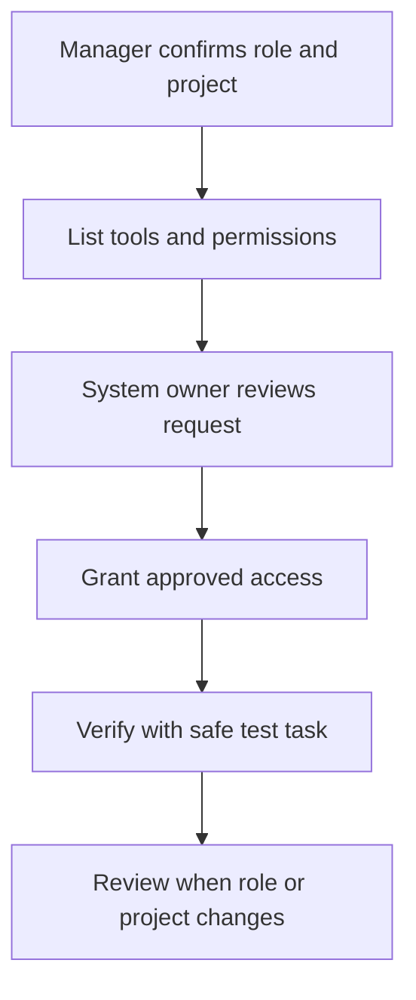

Your manager confirms your project and role before access is provisioned. The authorized system owner grants permissions needed for that work.

## Access flow

## Everyone's checklist

- [ ] Company account and approved communication channel.
- [ ] Project tracker, handbook, and private team directory.
- [ ] Role-appropriate customer or product workspace.
- [ ] Attendance and expense tools where applicable.
- [ ] Multifactor authentication where supported.
- [ ] Approved device configuration and credential storage.

Record blockers with the system name and required role. Do not paste passwords, tokens, recovery codes, or customer records into a ticket or handbook.

## Engineering and QA setup

1. Obtain the assigned repository and its setup guide from the technical owner.
2. Use the Node.js and package-manager versions pinned by that repository.
3. Install dependencies from its lockfile.
4. Obtain development configuration through approved secret sharing.
5. Use synthetic data or an approved sanitized dataset.
6. Run the application and required repository checks.
7. Complete a safe workflow and explain how to debug a failure.

<Note>
  This handbook is a separate Mintlify project. Its commands are under [maintaining the handbook](/quickstart). Product repositories may use different commands and versions.
</Note>

## Environment boundaries

| Environment | Purpose | Expected access |
| --- | --- | --- |
| Local/development | Build and experiment | Assigned contributors |
| Test/staging | Validate integrated workflows | Authorized engineering, QA, and reviewers |
| Production | Serve live operations | Explicitly approved operational roles |

Never use production as a convenient test dataset. The technical owner verifies necessary production activity and its recovery path.

## Ready to begin

You can access required tools, run or inspect your assigned workflow, identify the owner for help, and distinguish test from production. Missing access should not be hidden by borrowing a teammate's account.
