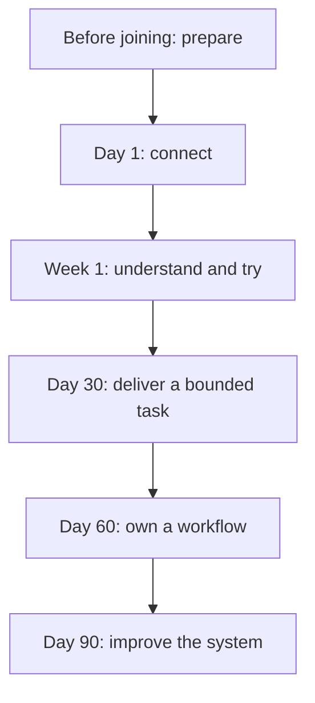

Onboarding should give you context, access, relationships, and a useful first contribution. Your manager owns the plan. A buddy helps with everyday questions. The functional owner confirms readiness for your responsibilities.

These checkpoints are planning guidelines, not automatic performance or probation decisions. Adjust them to your role, experience, access needs, and project.

## The journey

## Before you join

Your manager coordinates the start date, role, reporting relationship, buddy, and initial project. People/IT owners prepare approved accounts and equipment. Production access is not a default onboarding requirement.

## First day

- [ ] Meet your manager and buddy; confirm how to ask for help.
- [ ] Read [who we are](/company/overview) and [organization and ownership](/company/organization).
- [ ] Confirm your responsibilities and first-week plan.
- [ ] Complete the [access checklist](/onboarding/access-and-setup).
- [ ] Review the 9 AM–6 PM workday, 2–3 PM lunch break, attendance, expenses, information handling, and escalation.
- [ ] Confirm reporting/approval roles and the [coverage and exception route](/company/coverage-and-exceptions) for unavailable owners.
- [ ] Learn the [change request intake process](/company/ways-of-working#submit-and-track-a-change-request): all change requests and requests for new changes go through support@nextlabsonline.com.
- [ ] Schedule a customer-workflow walkthrough in a safe environment.

**Evidence:** you can explain your role, find the team, and access the tools needed to begin.

## First week

- [ ] Follow a representative workflow from the ground user to management.
- [ ] Review the relevant [domain playbook](/domains/overview).
- [ ] Review the [support cycle and SLA](/support/cycle-and-sla); learn how to report P0 service outages and follow a ticket through closure.
- [ ] Shadow planning, a review, or a customer demonstration.
- [ ] Complete a small task with a teammate and record what you learned.
- [ ] Agree your [role-specific path](/onboarding/role-paths).
- [ ] Discuss missing access or unclear ownership with your manager.

**Evidence:** a small reviewed contribution and a written list of remaining questions.

## First 30, 60, and 90 days

| Checkpoint | Learning outcome | Example evidence |
| --- | --- | --- |
| 30 days | Deliver a bounded task using the team's process | Reviewed change, test evidence, or accepted process document |
| 60 days | Own a complete workflow with support | Demonstration of normal flow and exceptions; clear handover |
| 90 days | Improve an area using observed evidence | Measurable improvement proposal and a completed action |

Agree actual outcomes with your manager. Completing onboarding means demonstrating relevant responsibilities, not reading every page or gaining every permission.

## Who helps you

| Owner | Responsibility |
| --- | --- |
| Manager | Scope the role, arrange introductions, remove blockers, review checkpoints |
| Buddy | Explain daily work, pair on the first task, help find answers |
| Functional owner | Confirm learning and approve role-specific responsibilities |
| New joiner | Ask questions, record blockers, demonstrate learning, improve unclear guidance |

Use the [onboarding record template](/reference/templates) in the approved internal workspace. Keep personal records out of this public site.
