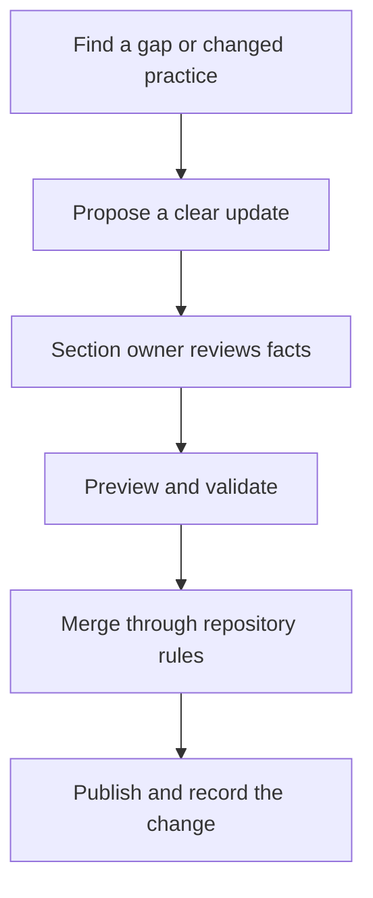

This is the first NextEdge handbook edition, prepared on 13 October 2026 from the company brief. It combines confirmed business context with proposed operating guidance.

## What is confirmed in this edition

- Eight years of company experience in IT services.
- ERP and mobile application work focused on business automation and productivity.
- Business domains: urban sustainability/waste management, Pharma ERP, Food and beverages ERP, and core banking.
- Membership, milestone programs, and spin-the-wheel loyalty are modules within Pharma ERP. Workforce operations support relevant domain workflows.
- A monolithic architecture direction using MongoDB, Node.js, Next.js, Hono/Express, and TypeScript.
- Final requirements and out-of-scope financial/billing approval are restricted to the designated Founder/CEO, SVP, or VP.
- Required intake of all change requests and requests for new changes through support@nextlabsonline.com, with linked records for future reference.
- Support restore/resolve targets measured in elapsed calendar time from receipt: P0 within 1 hour, P1 within 24 hours, P2 within 7 calendar days; the team provides P3/P4 schedules after review.
- Six delivery roles: Developer, Senior Developer, Product Owner/Manager, Technical Operations, UI/UX/Product Designer, and Senior Manager (Tech/Ops). Product Owner/Manager and UI/UX/Product Designer are peers and report directly to Senior Manager (Tech/Ops), alongside Senior Developer and Developer. Technical Operations reports only to Senior Manager (Tech/Ops). The Senior Manager reports to the designated Founder/CEO, SVP, or VP.
- Tech Ops owns testing, UAT, and production release/recovery sign-off; Senior Developer and Senior Manager (Tech/Ops) provide technical recovery help.
- When a primary owner is unavailable, seek the respective owner or authority permission, appoint a capable alternate, and coordinate execution and handover.
- Working hours are 9:00 AM–6:00 PM, with a one-hour lunch break from 2:00 PM–3:00 PM.

## Named owners and project configuration

Leadership should name the actual role holders and backups in the private team directory. The confirmed reporting and approval boundaries apply; project records identify the person exercising each responsibility. Other employment terms remain governed by approved company policies.

| Area | Accountable function | Project details to record |
| --- | --- | --- |
| Organization and decision rights | Senior Manager (Tech/Ops) with authorized leadership | Named people, confirmed reporting lines, designated leadership contacts, and backups |
| Onboarding and everyday operations | People owner with managers | Tools, contacts, working days/holiday schedule, approved leave/expense policies; workday/lunch hours are confirmed |
| Delivery and customer handoffs | Product Owner/Manager and Technical Operations, coordinated by Senior Manager (Tech/Ops) | Named owners, selected delivery method, cadence/WIP policies, approved requirements, escalation route |
| Change request intake and traceability | Support/delivery owner | Named intake owner and ticket tooling; support@nextlabsonline.com is the confirmed mailbox |
| Requirement and out-of-scope financial/billing approval | Founder/CEO, SVP, or VP only | Designated authorized approver, project approval route, written decision reference |
| Architecture and code practices | Technical owner | Project variations, actual module boundaries, mobile stack |
| Testing/UAT, release, and recovery | Tech Ops team with Senior Developer/Senior Manager (Tech/Ops) technical help | Named sign-off owner, backup, permission route, access, and recovery runbook |
| Support cycle and SLA measurement | Tech Ops with Senior Manager (Tech/Ops) coordination | Named coverage, monitoring, escalation, and alternate contacts across lunch/outside hours; calendar-time targets are confirmed |
| Domain playbooks | Delivery/business analysis with domain owner | Customer-specific workflows and verified feature scope |
| Handbook maintenance | Owner to be assigned by leadership | Review cadence and section reviewers |

## Confirmed approval and exception rules

| Responsibility | Confirmed rule |
| --- | --- |
| Operations management | Senior Manager, Technical/Operations manages operations; operations, product, design, and development report directly to this manager; Product Owner/Manager and Designer are peers |
| Requirement finalization | Founder/CEO, SVP, and VP are the only authorized final approvers |
| Commercial approval | Out-of-scope work and financial/billing terms require the designated authorized Founder/CEO, SVP, or VP decision |
| Testing, UAT, and production changes | Tech Ops owns sign-off; Senior Developer and Senior Manager (Tech/Ops) provide recovery help |
| Unavailable primary owner | Seek the respective owner/authority permission, name a capable alternate, coordinate affected roles, verify, and hand back |
| Workday and lunch | 9:00 AM–6:00 PM; lunch 2:00 PM–3:00 PM; calendar-time SLAs continue through coverage arrangements |

Record the exact project approval route without assuming that every decision needs a new sequential sign-off from all leadership titles. Technical Operations reports directly to Senior Manager (Tech/Ops) only. The Senior Manager reports to the designated Founder/CEO, SVP, or VP. The relationship among those leadership titles, working days, and named coverage contacts remain company configuration.

The [role operating rhythm](/company/operating-rhythm) provides daily, weekly, monthly, and quarterly working guidelines for all six roles. Managers agree review dates, project-specific measures, and named coverage; the guide does not invent employee assignments or performance quotas.

The [delivery methods guide](/delivery/delivery-methods) explains Waterfall, Agile, Kanban, and sprint-based workflows. Method selection, sprint duration, WIP limits, and review cadence are project choices to record; no single company-wide method or fixed sprint length has been confirmed.

See [project ownership](/reference/templates#project-ownership-record) and [coverage and exceptions](/company/coverage-and-exceptions).

{/* TODO: Record named owners/backups, approval routing, support coverage contacts, working-day calendar, and private policy sources. */}

## Maintain the handbook

Review a section when its process, owner, or underlying technology changes. The handbook owner should agree a recurring review cadence; no cadence has been confirmed for this edition.

## Boundaries

This site contains general company guidance and illustrative workflows. Keep employee records, customer information, access details, commercial contracts, and incident evidence in approved restricted systems. A private source repository does not by itself make a deployed website private.

Employment documents and approved company policies govern employment terms. Customer agreements and approved project specifications govern project commitments. Surface any conflict to the relevant owner and update the handbook after the decision.

## Edition history

| Date | Edition | Change |
| --- | --- | --- |
| 13 October 2026 | 1 | Company handbook, organization model, onboarding, delivery, domain playbooks, architecture, and workflow diagrams |
| 13 October 2026 | 1.1 | Added the initial out-of-scope financial/billing approval flow and change request template; authority clarified in edition 1.5 |
| 13 October 2026 | 1.2 | Required support email intake for all change requests and new changes; added traceability fields, onboarding guidance, and intake template |
| 13 October 2026 | 1.3 | Added support lifecycle, P0–P4 targets, rollback/hotfix recovery, escalation, and support ticket record |
| 13 October 2026 | 1.4 | Consolidated project-informed domain maps; renamed Food and beverages ERP and Pharma ERP, nested membership/loyalty under Pharma ERP, and added core banking |
| 13 October 2026 | 1.5 | Confirmed six-role responsibilities, product/development reporting to Senior Manager (Tech/Ops), leadership approval boundaries, Tech Ops sign-off, exception handovers, and work/lunch hours |
| 13 October 2026 | 1.6 | Clarified Senior Manager, Technical/Operations title, direct leadership reporting, product/design peer reporting, and added delivery methods with workflow diagrams |
| 13 October 2026 | 1.7 | Corrected Technical Operations to report only to Senior Manager, Technical/Operations; expanded operational responsibilities and added daily, weekly, monthly, and quarterly role routines |

See [maintaining the handbook locally](/quickstart) and [writing guidance](/guides/writing) for the editing process.
