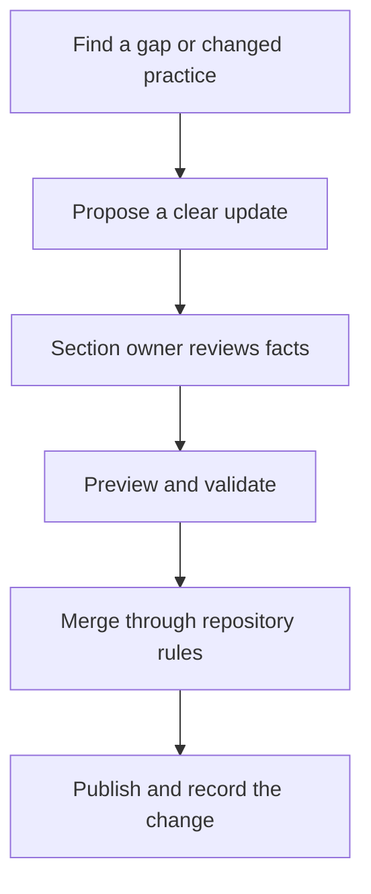

This is the first NextEdge handbook edition, prepared on 13 October 2026 from the company brief. It combines confirmed business context with proposed operating guidance.

## What is confirmed in this edition

- Eight years of company experience in IT services.
- ERP and mobile application work focused on business automation and productivity.
- Urban sustainability, pharma demand/fulfillment, and Hoisst ERP for food and beverages.
- Workforce operations and membership, milestone, and spin-the-wheel loyalty capabilities.
- A monolithic architecture direction using MongoDB, Node.js, Next.js, Hono/Express, and TypeScript.
- Written Founder/Product Owner approval for out-of-scope work and its financial and billing terms before committing to or starting that work.
- Required intake of all change requests and requests for new changes through support@nextlabsonline.com, with linked records for future reference.

## What needs an accountable owner

The role register below is intentionally unassigned. Leadership should appoint actual owners in the private team directory and record the adopted guideline version. Publishing this handbook does not establish a new reporting relationship or employment entitlement.

| Area | Proposed accountable function | Confirmation needed |
| --- | --- | --- |
| Organization and decision rights | Leadership | Reporting lines, named functional owners, delegated authority |
| Onboarding and everyday operations | People owner with managers | Tools, contacts, working hours, leave/expense policies |
| Delivery and customer handoffs | Delivery owner | Team cadence, acceptance authority, escalation route |
| Change request intake and traceability | Support/delivery owner | Named intake owner and ticket tooling; support@nextlabsonline.com is the confirmed mailbox |
| Out-of-scope financial and billing approval | Founder/Product Owner | Named approver and private approval-record location; approval authority is confirmed |
| Architecture and code practices | Technical owner | Project variations, actual module boundaries, mobile stack |
| Releases, security, and recovery | Technical/platform owner | Approval rules, support coverage, runbooks, recovery objectives |
| Domain playbooks | Delivery/business analysis with domain owner | Customer-specific workflows and verified feature scope |
| Handbook maintenance | Owner to be assigned by leadership | Review cadence and section reviewers |

{/* TODO: Confirm named owners, policy sources, project tooling, support coverage, and adopted guideline version with leadership. Store sensitive details in the private directory. */}

## Maintain the handbook

Review a section when its process, owner, or underlying technology changes. The handbook owner should agree a recurring review cadence; no cadence has been confirmed for this edition.

## Boundaries

This site contains general company guidance and illustrative workflows. Keep employee records, customer information, access details, commercial contracts, and incident evidence in approved restricted systems. A private source repository does not by itself make a deployed website private.

Employment documents and approved company policies govern employment terms. Customer agreements and approved project specifications govern project commitments. Surface any conflict to the relevant owner and update the handbook after the decision.

## Edition history

| Date | Edition | Change |
| --- | --- | --- |
| 13 October 2026 | 1 | Company handbook, organization model, onboarding, delivery, domain playbooks, architecture, and workflow diagrams |
| 13 October 2026 | 1.1 | Confirmed Founder/Product Owner approval for out-of-scope work, financial impact, and billing; updated flow and change request template |
| 13 October 2026 | 1.2 | Required support email intake for all change requests and new changes; added traceability fields, onboarding guidance, and intake template |

See [maintaining the handbook locally](/quickstart) and [writing guidance](/guides/writing) for the editing process.
