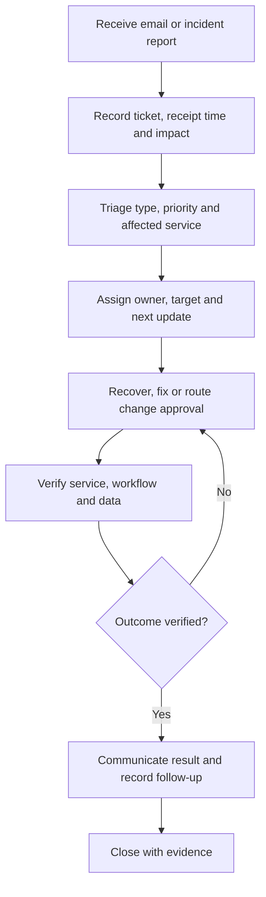
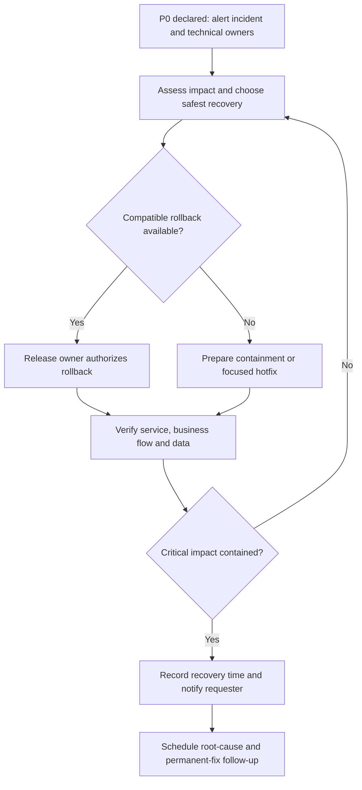

Use [support@nextlabsonline.com](mailto:support@nextlabsonline.com) to record support issues, change requests, and requests for new changes. Keep the original email thread and any assigned ticket reference linked to the work, decisions, and final outcome.

For a service outage or other critical incident, alert the project's incident contact immediately as well as recording the issue through support. Do not rely on an unread email to start urgent recovery.

## Support cycle

| Stage | Responsible role | Required record |
| --- | --- | --- |
| Intake | Support/delivery owner | Original thread, reference, receipt time, affected project and contact |
| Triage | Support with technical owner | Issue type, impact, priority, scope assessment |
| Assignment | Support/delivery owner | Accountable owner, target deadline or review plan, next update time |
| Recovery or fix | Assigned technical owner with release owner | Diagnosis, chosen action, approvals, implementation reference |
| Verification | QA/technical owner with affected workflow owner | Service checks, business-flow checks, data reconciliation where relevant |
| Closure | Support/delivery owner | Confirmed outcome, customer communication, evidence, remaining follow-up |

One owner remains accountable for the ticket even when several teams contribute. A handoff must name the receiving owner and preserve the original reference and timestamps.

## Priority and SLA targets

The targets below cover restoring or resolving the affected service or workflow. They are distinct from acknowledging an email or producing a final root-cause analysis.

| Priority | When to use it | Target | Expected action |
| --- | --- | --- | --- |
| **P0 — critical** | Production service down, a business-critical workflow unavailable without a viable workaround, or an active severe data-integrity/security incident | **Within 1 hour** | Restore service or contain the critical impact using a safe rollback, configuration recovery, workaround, or hotfix |
| **P1 — high** | Major functionality degraded or a significant operational issue requiring urgent correction, below P0 impact | **Within 24 hours** | Restore the affected workflow or resolve the issue; record any remaining permanent-fix work |
| **P2 — normal** | Non-critical defect or operational issue with limited impact and a usable workaround | **Within 1 week** | Resolve and verify the issue |
| **P3 — low** | Minor defect or improvement with low operational impact | **Team provides a schedule after review** | Assess effort and dependencies, communicate the planned date, then deliver |
| **P4 — planned** | New feature, enhancement, or other planned change | **Team provides a schedule after review** | Review scope and approvals, communicate the agreed schedule, then plan delivery |

Assign priority from business impact, not only from the requester's label. New features and enhancements follow change review; urgency alone does not bypass scope or billing approval.

## How timing is tracked

Measure the targets as **elapsed calendar time from receipt**: 1 hour for P0, 24 hours for P1, and 7 calendar days for P2. For an incident detected or reported directly before email intake, use the earlier recorded detection/report time. Ticket assignment or later email entry does not restart the clock.

<Note>
  Company leadership confirmed these restore/resolve targets and elapsed calendar-time measurement. Record support coverage, monitoring, and named escalation contacts in the project runbook so the team can meet them. Follow any customer-specific agreed SLA where it differs.
</Note>

Record the receipt time, priority decision, target deadline, recovery time, resolution time, and closure time separately. P3/P4 tickets need a review owner and next update time before the team can supply a delivery schedule.

When a dependency, missing information, or supplier issue threatens a target, record the blocker, escalate it, and communicate a revised recovery plan. Do not silently pause the clock, downgrade the ticket, or move the deadline. Preserve the history of any priority or schedule change.

## P0 recovery: restore first, then complete the fix

Use the named release/incident owner and the approved project runbook for recovery authorization. A rollback must be compatible with the current data and migrations. It does not undo external payments, stock movements, or notifications. A hotfix still needs focused review, relevant checks, smoke tests, and a recovery path.

Restoring availability is not proof that data is correct. Reconcile affected records and keep the incident open for remaining verification. Record permanent fixes and prevention work as linked follow-up with an owner and date.

## Escalation and communication

Escalate P0 immediately to the technical and incident owners. Escalate any P0/P1 recovery risk, likely SLA miss, unowned ticket, or blocked dependency as soon as it is known. Delivery coordinates customer updates; the Founder/Product Owner is involved where priorities, commercial decisions, or additional scope need authority.

Send updates on ownership, material changes, recovery, resolution, and closure through the same support thread. Each update should state current impact, action underway, owner, expected outcome or known uncertainty, and next update time.

## Change requests and approval

An incident or defect is not automatically an out-of-scope change. Support and delivery classify the request against the agreed scope. Follow the approved incident runbook for urgent recovery of existing service.

If a request adds or changes scope, use the [change approval flow](/company/ways-of-working#handle-a-change-in-scope). Out-of-scope work and its financial and billing terms require written Founder/Product Owner approval and recorded customer agreement before implementation. A P3/P4 schedule must account for those approvals.

## Close the loop

Before closure, link verification evidence, communicate the outcome, confirm the affected workflow, and record any remaining follow-up. If the issue recurs or verification fails, reopen the ticket or link a new incident and retain the earlier history.

Use the [support ticket record](/reference/templates#support-ticket-record) and [release and incident guidance](/engineering/releases-and-incidents).
